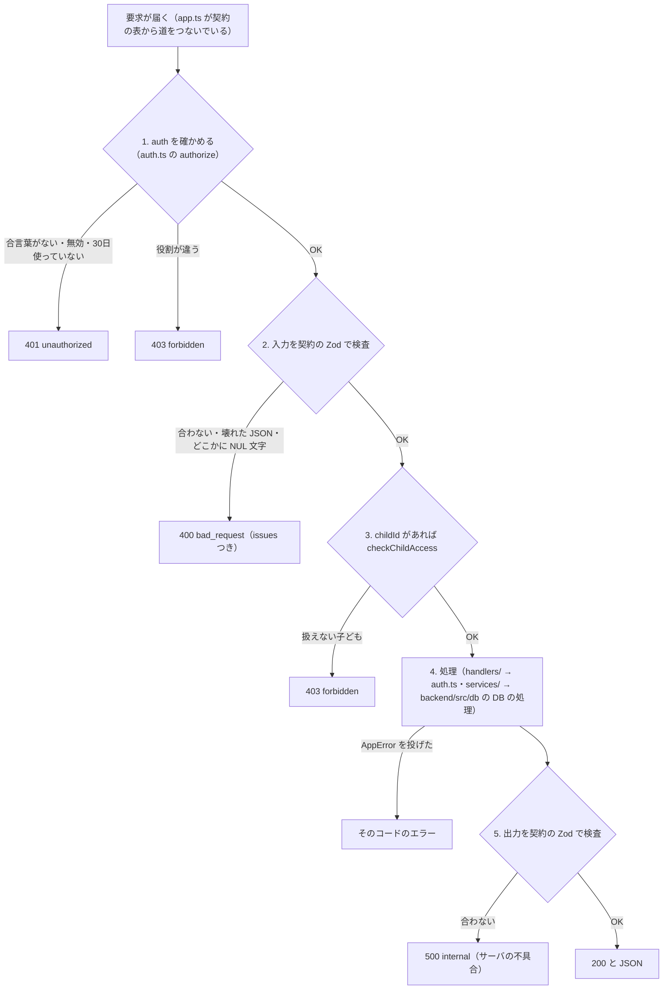

# サーバの窓口（API）

アプリとサーバの約束（契約）は `contracts/api.ts`（API の表）・`contracts/schemas.ts`（データの形）・`contracts/errors.ts`（エラー）にあります。
この文書はそれを読みやすく並べたものです。**食い違ったら `contracts/` が正しい**ので、こちらを直してください。

## 1. 決まりごと

- 道（path）は `/api/<機能>/<名前>`。
- 取得も含めて、入力があるものは **POST**（GET で条件を渡す仕組みはない）。入力がない取得の4本（`health`・`authMe`・`linkStatus`・`familyGet`）だけ GET。入力はないが状態を変える `authSignOut` は、本文を付けない POST（サーバは本文のない POST を「入力なし」として読む。`src/server/route.ts` の `readInput`）。
- 本文は JSON。合言葉は `Authorization: Bearer <token>` で付ける（アプリでは `src/lib/api.ts` の `call()` が自動で付ける）。
- 応答も契約の Zod で検査する。サーバの出力が契約と合わなければ `internal`（サーバの不具合）。
- `kind: "stream"`（少しずつ返す）の仕組みは残してあるが、今その形の API はない。

## 2. 誰が呼べるか（auth）

API ごとに `auth` が決まっています（`contracts/api.ts`）。

| auth | 呼べる人 |
|---|---|
| `none` | だれでも |
| `signedIn` | ログイン済みの人（紐づけ前の `role: null` も含む） |
| `parent` | 保護者だけ |
| `child` | 子どもだけ |

さらに、**入力に `childId` がある API** は、サーバが必ず次を確かめます（`src/server/auth.ts` の `checkChildAccess`）:

- 子ども: 自分の `childId`（自分の userId）だけ。ほかは `forbidden`「ほかの子どもの情報は扱えません」
- 保護者: D2 で連携済みの子どもだけ。ほかは `forbidden`「連携していない子どもの情報は扱えません」
- 紐づけ前（`role: null`）: どの子どもも扱えない。`forbidden`「まだ家族の連携が済んでいません」

そのため `signedIn` の API でも、`childId` があるものは実際には「連携済みの親子」だけが使えます。

### サーバの入口の順番

`src/server/route.ts` の `handle()` が、すべての API で次の順に通します（処理を書く人が忘れることはない）。



- **ログインの確認は入力の検査より先**です（ログインしていない人に入力の詳細を返さない）。
- 入力のどの文字列（キーも含む）にも NUL 文字（`\u0000`）は入れられない。契約の検査より先に `400 bad_request` で断る（Postgres が保存できず 500 になっていた。D-129）。
- 契約にない道は `404 not_found`（`app.ts` の `notFound`）。DB につながらない（止まっている・接続を断られた・切れた・時間切れ・閉じた）ときは `503 unavailable`（D-130）。DB を開けない理由が接続ではない（`DATABASE_URL` などの設定・migration の SQL の誤り）ときと、それ以外の想定外の例外は `500 internal`（中身は返さない）。

## 3. API の一覧

`expectedVersion` は「画面が読んだときの版」です（5章）。型の中身は [data.md](data.md) を見てください。

### ログイン・紐づけ（C1）

| 名前 | 道 | auth | 入力 | 出力 | 主なエラー |
|---|---|---|---|---|---|
| `health` | GET `/api/health` | none | なし | `{ ok: true, mock: boolean }` | 503 `unavailable`（DB につながらない・開けない。開けない理由によらず 503。`src/server/handlers/health.ts`） |
| `authGoogle` | POST `/api/auth/google` | none | `{ idToken }` | `Session`（`token`・`userId`・`name`・`role`） | 401（トークンが正しくない・`MOCK=1` でないのに `mock-`）、502 `upstream_failed`（サーバに `GOOGLE_WEB_CLIENT_ID` がない・Google の鍵が取れない）、429 `rate_limited`（同じ IP から1分に20回・同じ人から1分に10回をこえた。IP の分は Google の確かめより先に数える。D-131） |
| `authMe` | GET `/api/auth/me` | signedIn | なし | `Session` | 401 |
| `authSignOut` | POST `/api/auth/sign-out` | signedIn | なし（本文を付けない）か `{ otherDevices: true }` | `{ ok: true, revoked }`（`revoked` は無効にした合言葉の数）。本文なしなら呼んだ合言葉だけ、`otherDevices: true` なら同じ人のほかの合言葉をすべて無効にする（以後その合言葉は 401） | 401、400（知らない項目を入れた） |
| `pairStart` | POST `/api/pair/start` | signedIn | `{ name? }`（画面に出す呼び名） | `PairTicket`（`pairId`・`code`・`expiresAt`） | 409（保護者の端末・すでに連携済み）、429 `rate_limited`（1人1分に5回をこえた。D-131） |
| `pairStatus` | POST `/api/pair/status` | signedIn | `{ pairId }` | `PairStatus` | 404（自分が関わっていないペアリングも 404。あるかどうかを漏らさない） |
| `pairClaim` | POST `/api/pair/claim` | signedIn | `{ code }` | `PairStatus`（`claimed`） | 403（子どもの端末）、404（知らない番号）、409（期限切れ・使用済み・自分の QR・どちらかが連携済み）、429 `rate_limited`（10分のうちに 404・409 を10回。正しい番号でも断る。D-102） |
| `pairConfirm` | POST `/api/pair/confirm` | signedIn | `{ pairId, accept }` | `PairStatus`（`linked` か `rejected`） | 403（QR を出した子ども以外）、404、409（期限切れ・まだ読まれていない・役割が合わない・連携済み） |
| `pairCancel` | POST `/api/pair/cancel` | signedIn | `{ pairId }` | `PairStatus`（`waiting`・`claimed` は `expired` にする。`expired`・`rejected` はそのまま） | 403（QR を出した子ども以外）、404（関わっていないペアリング）、409（もう `linked`） |
| `linkStatus` | GET `/api/link/status` | signedIn | なし | `LinkStatus`（`state`・`role`・`partners`） | — |
| `familyGet` | GET `/api/family/get` | parent | なし | `Family`（`children`。MVP は最大1人） | 403（保護者以外） |
| `familyUnlink` | POST `/api/family/unlink` | parent | `{ childId }` | `FamilyUnlinkResult`（`childId`・`revokedSessions`）。連携を外し、子どもの合言葉をすべて無効にし、子どもの役割を `null` に戻し、子どもの出しかけの QR を `expired` にする。子どもの家庭ごとのデータ（利用記録・日別上限・計画・通常上限・テスト期間・空白期間・対象外アプリ・Web サイト・アプリ一覧とアイコン・端末の許可の状態）は同じトランザクションで消し、設定の版を 1 上げ、外した記録を `audit_events` に残す（D-101。`backend/src/db/family-unlink.ts`） | 403（保護者以外・連携していない子ども） |

### 通常上限・計画（D8）

| 名前 | 道 | auth | 入力 | 出力 | 主なエラー |
|---|---|---|---|---|---|
| `planGet` | POST `/api/plan/get` | signedIn | `{ childId }` | `PlanView`（`plan`・`usualLimitMinutes`・`configVersion`・`childAppliedVersion`） | 403 |
| `planSave` | POST `/api/plan/save` | parent | `{ childId, expectedVersion, planStartDate, startLimitMinutes, finalGoalMinutes, usualLimitMinutes? }` | `PlanSaveResult`（`plan`・`usualLimitMinutes`・`configVersion`・`calculationVersion`） | 400（G > S・開始日が今日より前・C10 が計算できない）、403、409（版のずれ） |
| `usualLimitSave` | POST `/api/plan/usual-limit` | parent | `{ childId, expectedVersion, usualLimitMinutes }` | `UsualLimitSaveResult`（`usualLimitMinutes`・`configVersion`・`calculationVersion`） | 403、409 |

### テスト期間（D3。親子どちらも。Q11）

| 名前 | 道 | auth | 入力 | 出力 | 主なエラー |
|---|---|---|---|---|---|
| `testPeriodList` | POST `/api/test-period/list` | signedIn | `{ childId }` | `TestPeriodList`（`testPeriods`（開始日の早い順）・`periodsChangedVersion`（テスト期間の一覧が最後に変わった版）・`configVersion`・`childAppliedVersion`） | 403 |
| `testPeriodCreate` | POST `/api/test-period/create` | signedIn | `{ childId, expectedVersion, name, startDate, endDate }` | `TestPeriodSaveResult`（`testPeriod`・`configVersion`・`calculationVersion`） | 400（終了日 < 開始日・空の名前・ほかのテストと重なる・C10 が計算できない）、403、409 |
| `testPeriodUpdate` | POST `/api/test-period/update` | signedIn | 上と同じ ＋ `id` | `TestPeriodSaveResult` | 上と同じ ＋ 404（その id がない） |
| `testPeriodDelete` | POST `/api/test-period/delete` | signedIn | `{ childId, expectedVersion, id }` | `PeriodDeleteResult`（`deletedId`・`configVersion`・`calculationVersion`） | 403、404、409 |

作った人（`createdByUserId`・`createdByRole`）はサーバが付け、更新しても変わりません（送っても無視）。

### 空白期間（Q7。保護者だけ）

| 名前 | 道 | auth | 入力 | 出力 | 主なエラー |
|---|---|---|---|---|---|
| `blankPeriodList` | POST `/api/blank-period/list` | parent | `{ childId }` | `BlankPeriodList`（`blankPeriods`・`blankChangedVersion`（空白期間の一覧が最後に変わった版）・`configVersion`・`childAppliedVersion`） | 403（子どもも 403。子どもは `configGet` の `blankPeriods` で見る） |
| `blankPeriodCreate` | POST `/api/blank-period/create` | parent | `{ childId, expectedVersion, name, startDate, endDate }` | `BlankPeriodSaveResult` | 400（空白期間どうしの重なりなど）、403、409 |
| `blankPeriodUpdate` | POST `/api/blank-period/update` | parent | 上と同じ ＋ `id` | `BlankPeriodSaveResult` | 上と同じ ＋ 404 |
| `blankPeriodDelete` | POST `/api/blank-period/delete` | parent | `{ childId, expectedVersion, id }` | `PeriodDeleteResult` | 403、404、409 |

テスト期間と空白期間は重なってかまいません（空白期間の日は「制限なし」が勝つ）。

### 設定の組（C7）

| 名前 | 道 | auth | 入力 | 出力 | 主なエラー |
|---|---|---|---|---|---|
| `configGet` | POST `/api/config/get` | signedIn | `{ childId, knownVersion? }` | `ConfigResult`：同じ版なら `{ changed: false, configVersion, epoch }`、違えば `{ changed: true, snapshot, epoch }` | 403 |

`epoch` は**サーバの DB ごとに決まる値**（文字列。DB を作ったときに1回だけ作る uuid。表 `server_meta`）で、どちらの応答にも必ず入ります（D-109）。DB を作り直す・PGlite と Neon を切り替えると変わり、サーバを再起動しても変わりません。版（`configVersion`）は DB の中の数なので、DB が変わると 0 から数え直します。端末は手元の組の epoch と違えば版を比べずに手元を捨て、`changed: false` なら `knownVersion` なしで取り直します（[flows.md の C7](flows.md)）。

**子どもが呼んだとき**は、送った `knownVersion` を「子どもの端末が使っている版」（`childAppliedVersion`）として覚えます（サーバの版より大きい値は覚えない）。保護者が呼んでも変わりません。

まだ一度も日別上限を計算していない子ども（紐づけ直後で、通常上限も計画も保存していない）には、エラーにせず `calculationVersion: 0`・日別上限なし（上限未設定）を返します。

日別上限の残りが 60 日を切っていたら、`configGet` のときに今日から 120 日先まで作り足し、設定の版を 1 上げます（`backend/src/db/c10-recalculate.ts` の `topUpDailyLimits`。D-54）。読む API で版が上がるのはこのときだけです。

### 利用記録（C8・C6）

| 名前 | 道 | auth | 入力 | 出力 | 主なエラー |
|---|---|---|---|---|---|
| `usageUpload` | POST `/api/usage/upload` | child | `{ submissionId（UUID）, childId, days（1〜7日分）}` | `UsageUploadResult`（`submissionId`・`status: accepted / duplicate`・`appliedDates`） | 400（形が違う・`measuredAt` がタイムゾーンつきの日時でない・今日（日本時間）の190日前〜明日の外の日がある。D-127）、403（保護者・ほかの子ども）、409（同じ送信 ID で中身が違う・ほかの子どもの送信 ID） |
| `usageGet` | POST `/api/usage/get` | parent | `{ childId, from, to }`（両端を含む。190日未満） | `ParentUsageView`（`days`（from〜to の全日）・`lastUploadedAt`） | 400（from > to・長すぎる）、403 |

### 制限対象外アプリ（C9）

| 名前 | 道 | auth | 入力 | 出力 | 主なエラー |
|---|---|---|---|---|---|
| `excludedAppsGet` | POST `/api/excluded-apps/get` | signedIn | `{ childId }` | `ExcludedAppsView`（`apps`・`removedApps`（外したアプリと外した版）・`appsChangedVersion`（一覧が最後に変わった版）・`configVersion`・`childAppliedVersion`） | 403 |
| `excludedAppsSave` | POST `/api/excluded-apps/save` | parent | `{ childId, expectedVersion, apps（全件。500件まで）}` | `ExcludedAppsSaveResult`（`apps`・`configVersion`） | 403（子どもは保存できない）、409 |

### 制限する Web サイト（D-111）

上限に達したあと、子どもの端末のブラウザで開くと止めるサイト（Kotlin のユーザー補助 `engine/WebGuardService.kt` が止める）。子どもの端末へは C7 の組の `blockedSites` で届きます。

| 名前 | 道 | auth | 入力 | 出力 | 主なエラー |
|---|---|---|---|---|---|
| `blockedSitesGet` | POST `/api/blocked-sites/get` | signedIn | `{ childId }` | `BlockedSitesView`（`sites`（`pattern`・`sinceVersion`。登録した版の古い順）・`sitesChangedVersion`（一覧が最後に変わった版。0 = 一度も変えていない）・`configVersion`・`childAppliedVersion`） | 403 |
| `blockedSitesSave` | POST `/api/blocked-sites/save` | parent | `{ childId, expectedVersion, sites（全件。100件まで。そろえた形の文字）}` | `BlockedSitesSaveResult`（`sites`・`sitesChangedVersion`・`configVersion`） | 400（そろえていない形・ドメインでない・同じものが2つ・数と長さの上限）、403（子どもは保存できない）、409 |

- 登録の形は `"youtube.com"`（サイト全体。サブドメインもふくむ）か `"youtube.com/shorts"`（ドメインが合い、パスがその前置きで始まるページだけ。区切りの `/` で比べるので `/shortstory` は当たらない）。
- 入力は `contracts/web-sites.ts` の `normalizeSitePattern` でそろえた形だけを受け付けます（https://・www.・大文字・末尾の `/` を外した形。200 文字まで。`?`・`#`・ポート番号・IP アドレス・日本語のドメインは断る）。画面が保存の前にそろえ、サーバは「そろえ直しても同じか」を入口で確かめます（`SitePattern`）。
- 読むときの `pattern` は形を確かめ直しません（そろえ方の規則をあとで変えても、保存済みの C7 の組が読めなくならないように）。子どもの端末の Kotlin は受け取った登録をもう一度そろえ、そろわないものは使いません。
- 中身が同じ保存（順番だけ違うものもふくむ）は版を上げません。外した登録は消し、外したことが届いたかは `sitesChangedVersion` で見ます。

### 子どもの端末のアプリ一覧とアイコン（Q15・D-110）

親16 の候補（子どもの端末のホーム画面に出るアプリ）と、親09・親16 のアプリの本物のアイコン。送るのは packageName・表示名・アイコン（PNG）だけで、使用時間は C8 で別に送ります。設定の版は上げません（親の設定ではないので、親05・親16 が「反映待ち」にならない）。

| 名前 | 道 | auth | 入力 | 出力 | 主なエラー |
|---|---|---|---|---|---|
| `childAppsUpload` | POST `/api/child-apps/upload` | child | `{ childId, apps（全件。1000件まで）: [{ packageName（255文字まで）, label（120文字まで）, iconHash?（PNG の SHA-256・16進 64 文字）}] }` | `ChildAppsUploadResult`（`appCount`・`receivedAt`・`iconsNeeded`（サーバにない・中身が違うアイコンのアプリ）） | 400（件数・長さの上限・空白だけの文字・同じアプリが2回）、403（保護者・ほかの子ども） |
| `childAppIconsUpload` | POST `/api/child-apps/icons/upload` | child | `{ childId, icons（1〜50枚）: [{ packageName, iconHash, png（base64）}] }` | `ChildAppIconsUploadResult`（`saved`：保存した枚数。今の一覧にないアプリの分は保存せず数えない） | 400（PNG でない・20KB を超える・base64 が正しくない・ハッシュが中身と合わない・51 枚以上）、403 |
| `childAppsGet` | POST `/api/child-apps/get` | parent | `{ childId }` | `ChildAppsView`（`apps`（表示名の順。`iconHash` はサーバにあるアイコンのハッシュ、なければ `null`）・`receivedAt`（まだ届いていなければ `null`）） | 403（子どもは自分の分でも 403・連携していない子ども） |
| `childAppIconsGet` | POST `/api/child-apps/icons/get` | parent | `{ childId, packageNames（1〜50個）}` | `ChildAppIconsView`（`icons`：頼んだうちサーバにあるものだけ） | 400（51 個以上）、403 |

- `childAppsUpload` は全件の置き換えです。送らなかったアプリは一覧から消え、そのアイコンも消えます。`receivedAt: null`（まだ届いていない）と、届いた一覧が空（`apps: []`）は分けます。
- 端末はアイコンの画像を一覧に入れず、ハッシュだけを入れます。サーバが `iconsNeeded` で返したアプリのアイコンだけを、50 枚ずつ `childAppIconsUpload` で送ります（`src/lib/child-apps-sync.ts`）。
- サーバはアイコンの中身を確かめます（base64 を読み直して同じになる・PNG の頭・20KB 以下・SHA-256 が `iconHash` と同じ。`src/server/services/child-apps.ts` の `checkIconPng`）。保護者の端末はこの中身をそのまま画像として出すためです。
- 保護者の端末は、端末にない・ハッシュが変わったアイコンだけを 50 個ずつ `childAppIconsGet` で読みます（`src/lib/app-icons.ts`）。
- `excludedAppsGet` に入れない理由: 親16 は `excludedAppsGet` を 30 秒ごとに取り直すので、数百件の一覧を毎回運ばないためです。

### 許可の見張りと親への通告（D-113）

子どもの端末の許可（使用状況へのアクセス・他のアプリの上に表示・通知・ユーザー補助）の状態。**送るのは JS ではなく Kotlin の監視（`engine/StatusReporter.kt`）** で、アプリを閉じていても、変わったときと 15 分ごとの生存報告で送ります（Kotlin がサーバへ直接送るのはこの API だけ）。送る中身は許可ごとのオン/オフと測った時刻だけです（使用時間・アプリ名・URL は送らない）。設定の版は上げません。

| 名前 | 道 | auth | 入力 | 出力 | 主なエラー |
|---|---|---|---|---|---|
| `deviceStatusReport` | POST `/api/device-status/report` | child | `{ childId, permissions: { usageAccess, overlay, notifications, accessibility（すべて真偽）}, measuredAt }`（`childId` は自分の分だけ。保存先も合言葉の本人） | `DeviceStatusReportResult`（`{ ok: true }`） | 400（許可が足りない・真偽でない・時刻でない・`childId` がない）、401（合言葉が無効。Kotlin は保存した合言葉を消して送るのをやめる）、403（保護者・紐づけ前の人・ほかの子どもの `childId`） |
| `deviceStatusGet` | POST `/api/device-status/get` | parent | `{ childId }` | `DeviceStatusView`（`{ status: ChildDeviceStatus \| null }`。`null` = まだ一度も届いていない。`ChildDeviceStatus` は `permissions`（許可ごとの真偽）・`offSince`（許可ごとのオフになった時刻。オンなら `null`）・`measuredAt`・`lastSeenAt`（サーバに最後に届いた時刻）） | 403（子どもは自分の分でも 403・連携していない子ども） |

- `offSince` は「最初にオフと届いた報告の測った時刻」です。オフのまま届き続けても変えず、オンに戻ると消えます。端末の時計がサーバより先に進んでいても、サーバの今より先にはしません。
- 前に届いた報告より古い（遅れて届いた）報告は状態を変えず、`lastSeenAt` だけ進めます。
- 保護者が子どもとの連携を外すと消します（`familyUnlink`。次に紐づけた保護者に前の様子を見せない）。
- `familyGet` に入れない理由: `familyGet` は親の画面全体で共有する子どもの一覧（名前）の入口で、これは親01 だけが 30 秒ごとに読むためです。

## 4. エラーの形

どの API も、失敗したら必ずこの形で返します（`contracts/errors.ts` の `ApiError`）。画面は `message` と `hint` をそのまま出せばよい作りです。

```json
{
  "code": "conflict",
  "message": "ほかの端末で先に変更されました",
  "hint": "画面を更新して、もう一度変更してください",
  "issues": [{ "path": "finalGoalMinutes", "message": "…" }]
}
```

- `message`: 何が起きたか（利用者に見せる文）
- `hint`: 次に何をすればよいか（利用者に見せる文）
- `issues`: `bad_request` のときだけ。どの項目がなぜだめか（開発者向け）

| code | HTTP | 意味 | 既定の文（message ／ hint） |
|---|---|---|---|
| `bad_request` | 400 | 入力が契約と合わない・計算できない入力 | 入力の内容を受け付けられませんでした ／ 入力を見直して、もう一度送ってください |
| `unauthorized` | 401 | 合言葉がない・無効 | ログインが確認できませんでした ／ もう一度 Google でログインしてください |
| `forbidden` | 403 | その役割ではできない・扱えない子ども | この操作はできません ／ 保護者の端末から操作してください |
| `not_found` | 404 | 対象がない | 見つかりませんでした ／ 最初の画面からやり直してください |
| `conflict` | 409 | 状態が合わない（版のずれ・二重登録など） | すでに処理されています ／ 画面を更新してください |
| `upstream_failed` | 502 | 外部のサービス（Google など）が失敗 | 外部のサービスが応答しませんでした ／ 少し待ってから、もう一度押してください |
| `timeout` | 504 | 時間切れ | 時間がかかりすぎて中断しました ／ もう一度押してください |
| `rate_limited` | 429 | 呼び出し回数の上限（`pairClaim` のまちがい・`authGoogle`・`pairStart`。D-102・D-131） | 混み合っています ／ 30秒ほど待ってから、もう一度押してください |
| `unavailable` | 503 | DB につながらないなど、一時的に使えない（どの API でも。`health` も。D-130）。古い版のアプリは知らない code を `internal` として扱う | ただいま使えません ／ 少し待ってから、もう一度押してください |
| `network` | 0 | 通信できない（**アプリ側でだけ作る**。サーバで投げても `upstream_failed` になる） | 通信できませんでした ／ 接続を確認して、もう一度押してください |
| `internal` | 500 | それ以外のサーバの不具合 | うまく処理できませんでした ／ もう一度押してください。続く場合は担当者に伝えてください |

サーバは状況に合った文で上書きします（例: 版のずれは「ほかの端末で先に変更されました」、期間の重なりは「「数学」と期間が重なっています」）。
サーバの処理の中では `throw new AppError("not_found", "文", "次にすること")` と書き、形の変換は `src/server/errors.ts` の `toApiError` に任せます。

### アプリ側での受け取り方（`src/lib/api.ts`）

- 失敗は必ず `ApiCallError` で投げられる。画面は `catch (e) { setError(errorOf(e)) }` とし、`ErrorBanner` などで出す。
- `errorOf(e)` は、自分で中断した（画面を離れた）ときだけ `null` を返す（何も出さない）。
- 時間制限は `{ signal: timeoutSignal(ミリ秒) }`。紐づけの画面は 15 秒にしている。
- 合言葉を付けて 401 が返ったら、`session.tsx` がログアウト状態にする。
- つなぎ先は `EXPO_PUBLIC_API_URL`。空なら `http://10.0.2.2:3000`（Android エミュレータから見た手元の PC）。

## 5. 版（expectedVersion）の決まり

子ども1人につき、設定の版（`configVersion`）は1本です（Q6）。

| 決まり | 担当 |
|---|---|
| 版は 0 から始まる（0 = まだ何も保存していない。DB の `child_config_versions.version` の既定 0。D-104）。紐づけの確定で器ができる | `src/server/auth.ts` の `confirmPair`・`backend/src/db/*.ts` |
| 設定を変える10種類の API（`planSave`・`usualLimitSave`・`testPeriodCreate/Update/Delete`・`blankPeriodCreate/Update/Delete`・`excludedAppsSave`・`blockedSitesSave`）は、成功すると版をちょうど **1** 上げる（中身の変わらない `excludedAppsSave`・`blockedSitesSave` は上げない） | `backend/src/db/*.ts` の保存の処理（版の確かめ・変更・版を上げるを1回のトランザクションで） |
| これらは `expectedVersion` を受け取り、今の版と**違えば**（古くても新しくても）`409 conflict`「ほかの端末で先に変更されました」。何も変えない | 同上 |
| 日別上限を作り直した保存では `calculationVersion` も 1 上がる（`excludedAppsSave`・`blockedSitesSave` は作り直さないので上がらない） | `backend/src/db/c10-recalculate.ts` の `recalculateC10InTransaction` |
| 読む API（`planGet`・`testPeriodList`・`blankPeriodList`・`excludedAppsGet`・`blockedSitesGet`・`configGet`）は今の `configVersion` を返す。画面はこれを次の `expectedVersion` に使う | `src/server/services/*.ts` |
| `configGet` に `knownVersion` を送ると、同じ版なら中身を省く | `src/server/services/config-snapshot.ts` の `getConfigForCaller` |
| `configGet` の応答には、どちらの形にも DB の `epoch` を入れる（D-109） | 同上（`backend/src/db/server-epoch.ts` の `readServerEpoch`） |
| 子どもが送った `knownVersion` は `childAppliedVersion` として覚え、読む API で返す（「反映済み／反映待ち」に使う） | 同上（表 `child_applied_versions`） |
| `configGet` で日別上限を作り足したとき（残り 60 日を切ったとき。D-54） | `topUpDailyLimits` |
| 保存した計画の `plan.version`、対象外アプリの `sinceVersion`（対象外になった版）・`removedVersion`（外した版）・`appsChangedVersion`（一覧が最後に変わった版。同じ中身の保存では進まない）は、その変更が入った版 | `backend/src/db/plan-settings.ts`・`excluded-app-settings.ts` |
| 制限する Web サイトの `sinceVersion`（足した版。もとからある登録は変わらない）・`sitesChangedVersion`（足した・外したが最後にあった版。同じ中身の保存では進まない）は、その変更が入った版 | `backend/src/db/blocked-sites.ts`（表 `blocked_sites`・`blocked_site_states`） |
| テスト期間の `periodsChangedVersion`・空白期間の `blankChangedVersion` は、その一覧（名前・期間）が最後に変わった版（一度も変わっていなければ 0）。ほかの設定の保存・同じ中身の更新・失敗した保存では進まない。親05・空白期間の一覧の「反映済み／反映待ち」は、`childAppliedVersion` がこれ以上かで決める（0 なら反映済み。`schedule/logic.ts` の `appliedStatus`） | `backend/src/db/test-periods.ts`・`blank-periods.ts`（DB の列 `test_periods_changed_version`・`blank_periods_changed_version`） |

画面がどの版を送るか:

- 日程の**変更・削除**: 入力を始めた時点の版（`PeriodEditor.tsx`）。**登録**: 最新の版。
- 計画（親02）: 画面を開いて最初に読んだ版。保存できたら、または conflict のあと、取り直した版に替える（`plan.tsx`）。入力は残す。
- 通常上限: `planGet` で読んだ版（`usual-limit.tsx`）。conflict なら取り直す。
- 対象外アプリ（親16）: スイッチを読み込んだときの版。
- 制限する Web サイト: 下書きを読み込んだときの版（保存していない変更がなければ、30 秒ごとの取り直しで今の版に合わせ直す。`parent/blocked-sites.ts` の `syncSitesDraft`）。

## 6. API を足すとき

1. `contracts/schemas.ts` に入力と出力の形を足す。
2. `contracts/api.ts` の `api` の表に1行足す（`post(path, auth, 入力, 出力)`）。
3. `src/server/handlers/<API 名>.ts` を作り、`handle("<API 名>", async (req, ctx) => …)` を default export する。
4. `src/server/handlers/index.ts` から export する（足りないと `npm run typecheck` で `src/server/app.ts` が型エラーになる）。
5. アプリからは `call("<API 名>", 入力)` で呼ぶ。
6. この文書の表に1行足す。
