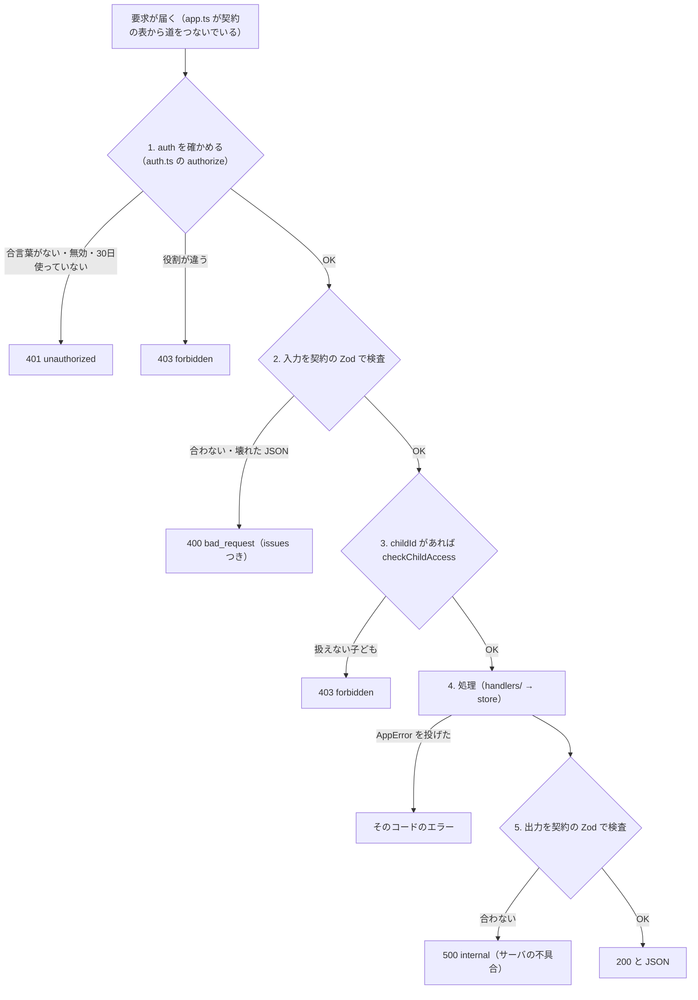

# サーバの窓口（API）

アプリとサーバの約束（契約）は `contracts/api.ts`（API の表）・`contracts/schemas.ts`（データの形）・`contracts/errors.ts`（エラー）にあります。
この文書はそれを読みやすく並べたものです。**食い違ったら `contracts/` が正しい**ので、こちらを直してください。

## 1. 決まりごと

- 道（path）は `/api/<機能>/<名前>`。
- 取得も含めて、入力があるものは **POST**（GET で条件を渡す仕組みはない）。入力がない取得の4本（`health`・`authMe`・`linkStatus`・`familyGet`）だけ GET。入力はないが状態を変える `authSignOut` は、本文を付けない POST（サーバは本文のない POST を「入力なし」として読む。`src/server/route.ts` の `readInput`）。
- 本文は JSON。合言葉は `Authorization: Bearer <token>` で付ける（アプリでは `src/lib/api.ts` の `call()` が自動で付ける）。
- 応答も契約の Zod で検査する。サーバの出力が契約と合わなければ `internal`（サーバの不具合）。
- `kind: "stream"`（少しずつ返す）の仕組みは残してあるが、今その形の API はない。

## 2. 誰が呼べるか（auth）

API ごとに `auth` が決まっています（`contracts/api.ts`）。

| auth | 呼べる人 |
|---|---|
| `none` | だれでも |
| `signedIn` | ログイン済みの人（紐づけ前の `role: null` も含む） |
| `parent` | 保護者だけ |
| `child` | 子どもだけ |

さらに、**入力に `childId` がある API** は、サーバが必ず次を確かめます（`src/server/auth.ts` の `checkChildAccess`）:

- 子ども: 自分の `childId`（自分の userId）だけ。ほかは `forbidden`「ほかの子どもの情報は扱えません」
- 保護者: D2 で連携済みの子どもだけ。ほかは `forbidden`「連携していない子どもの情報は扱えません」
- 紐づけ前（`role: null`）: どの子どもも扱えない。`forbidden`「まだ家族の連携が済んでいません」

そのため `signedIn` の API でも、`childId` があるものは実際には「連携済みの親子」だけが使えます。

### サーバの入口の順番

`src/server/route.ts` の `handle()` が、すべての API で次の順に通します（処理を書く人が忘れることはない）。



- **ログインの確認は入力の検査より先**です（ログインしていない人に入力の詳細を返さない）。
- 契約にない道は `404 not_found`（`app.ts` の `notFound`）。想定外の例外は `500 internal`（中身は返さない）。

## 3. API の一覧

`expectedVersion` は「画面が読んだときの版」です（5章）。型の中身は [data.md](data.md) を見てください。

### ログイン・紐づけ（C1）

| 名前 | 道 | auth | 入力 | 出力 | 主なエラー |
|---|---|---|---|---|---|
| `health` | GET `/api/health` | none | なし | `{ ok: true, mock: boolean }` | — |
| `authGoogle` | POST `/api/auth/google` | none | `{ idToken }` | `Session`（`token`・`userId`・`name`・`role`） | 401（トークンが正しくない・`MOCK=1` でないのに `mock-`）、502 `upstream_failed`（サーバに `GOOGLE_WEB_CLIENT_ID` がない・Google の鍵が取れない） |
| `authMe` | GET `/api/auth/me` | signedIn | なし | `Session` | 401 |
| `authSignOut` | POST `/api/auth/sign-out` | signedIn | なし（本文を付けない） | `{ ok: true }`。呼んだ合言葉をサーバから消す（以後その合言葉は 401。同じ人のほかの端末の合言葉は残る） | 401、400（本文に何か入れた） |
| `pairStart` | POST `/api/pair/start` | signedIn | `{ name? }`（画面に出す呼び名） | `PairTicket`（`pairId`・`code`・`expiresAt`） | 409（保護者の端末・すでに連携済み） |
| `pairStatus` | POST `/api/pair/status` | signedIn | `{ pairId }` | `PairStatus` | 404（自分が関わっていないペアリングも 404。あるかどうかを漏らさない） |
| `pairClaim` | POST `/api/pair/claim` | signedIn | `{ code }` | `PairStatus`（`claimed`） | 403（子どもの端末）、404（知らない番号）、409（期限切れ・使用済み・自分の QR・どちらかが連携済み） |
| `pairConfirm` | POST `/api/pair/confirm` | signedIn | `{ pairId, accept }` | `PairStatus`（`linked` か `rejected`） | 403（QR を出した子ども以外）、404、409（期限切れ・まだ読まれていない・役割が合わない・連携済み） |
| `pairCancel` | POST `/api/pair/cancel` | signedIn | `{ pairId }` | `PairStatus`（`waiting`・`claimed` は `expired` にする。`expired`・`rejected` はそのまま） | 403（QR を出した子ども以外）、404（関わっていないペアリング）、409（もう `linked`） |
| `linkStatus` | GET `/api/link/status` | signedIn | なし | `LinkStatus`（`state`・`role`・`partners`） | — |
| `familyGet` | GET `/api/family/get` | parent | なし | `Family`（`children`。MVP は最大1人） | 403（保護者以外） |

### 通常上限・計画（D8）

| 名前 | 道 | auth | 入力 | 出力 | 主なエラー |
|---|---|---|---|---|---|
| `planGet` | POST `/api/plan/get` | signedIn | `{ childId }` | `PlanView`（`plan`・`usualLimitMinutes`・`configVersion`・`childAppliedVersion`） | 403 |
| `planSave` | POST `/api/plan/save` | parent | `{ childId, expectedVersion, planStartDate, startLimitMinutes, finalGoalMinutes, usualLimitMinutes? }` | `PlanSaveResult`（`plan`・`usualLimitMinutes`・`configVersion`・`calculationVersion`） | 400（G > S・開始日が今日より前・C10 が計算できない）、403、409（版のずれ） |
| `usualLimitSave` | POST `/api/plan/usual-limit` | parent | `{ childId, expectedVersion, usualLimitMinutes }` | `UsualLimitSaveResult`（`usualLimitMinutes`・`configVersion`・`calculationVersion`） | 403、409 |

### テスト期間（D3。親子どちらも。Q11）

| 名前 | 道 | auth | 入力 | 出力 | 主なエラー |
|---|---|---|---|---|---|
| `testPeriodList` | POST `/api/test-period/list` | signedIn | `{ childId }` | `TestPeriodList`（`testPeriods`（開始日の早い順）・`periodsChangedVersion`（テスト期間の一覧が最後に変わった版）・`configVersion`・`childAppliedVersion`） | 403 |
| `testPeriodCreate` | POST `/api/test-period/create` | signedIn | `{ childId, expectedVersion, name, startDate, endDate }` | `TestPeriodSaveResult`（`testPeriod`・`configVersion`・`calculationVersion`） | 400（終了日 < 開始日・空の名前・ほかのテストと重なる・C10 が計算できない）、403、409 |
| `testPeriodUpdate` | POST `/api/test-period/update` | signedIn | 上と同じ ＋ `id` | `TestPeriodSaveResult` | 上と同じ ＋ 404（その id がない） |
| `testPeriodDelete` | POST `/api/test-period/delete` | signedIn | `{ childId, expectedVersion, id }` | `PeriodDeleteResult`（`deletedId`・`configVersion`・`calculationVersion`） | 403、404、409 |

作った人（`createdByUserId`・`createdByRole`）はサーバが付け、更新しても変わりません（送っても無視）。

### 空白期間（Q7。保護者だけ）

| 名前 | 道 | auth | 入力 | 出力 | 主なエラー |
|---|---|---|---|---|---|
| `blankPeriodList` | POST `/api/blank-period/list` | parent | `{ childId }` | `BlankPeriodList`（`blankPeriods`・`blankChangedVersion`（空白期間の一覧が最後に変わった版）・`configVersion`・`childAppliedVersion`） | 403（子どもも 403。子どもは `configGet` の `blankPeriods` で見る） |
| `blankPeriodCreate` | POST `/api/blank-period/create` | parent | `{ childId, expectedVersion, name, startDate, endDate }` | `BlankPeriodSaveResult` | 400（空白期間どうしの重なりなど）、403、409 |
| `blankPeriodUpdate` | POST `/api/blank-period/update` | parent | 上と同じ ＋ `id` | `BlankPeriodSaveResult` | 上と同じ ＋ 404 |
| `blankPeriodDelete` | POST `/api/blank-period/delete` | parent | `{ childId, expectedVersion, id }` | `PeriodDeleteResult` | 403、404、409 |

テスト期間と空白期間は重なってかまいません（空白期間の日は「制限なし」が勝つ）。

### 設定の組（C7）

| 名前 | 道 | auth | 入力 | 出力 | 主なエラー |
|---|---|---|---|---|---|
| `configGet` | POST `/api/config/get` | signedIn | `{ childId, knownVersion? }` | `ConfigResult`：同じ版なら `{ changed: false, configVersion }`、違えば `{ changed: true, snapshot }` | 403 |

**子どもが呼んだとき**は、送った `knownVersion` を「子どもの端末が使っている版」（`childAppliedVersion`）として覚えます（サーバの版より大きい値は覚えない）。保護者が呼んでも変わりません。

日別上限の残りが 60 日を切っていたら、`configGet` が今日から 120 日先まで作り足します（中身が変わったときだけ版が 1 上がる。[flows.md の 5章](flows.md)）。そのため、**読む API でも版が上がることがあります**。保護者がその前に読んだ版で保存すると conflict になるので、画面は読み直して保存し直します。

### 利用記録（C8・C6）

| 名前 | 道 | auth | 入力 | 出力 | 主なエラー |
|---|---|---|---|---|---|
| `usageUpload` | POST `/api/usage/upload` | child | `{ submissionId（UUID）, childId, days（1〜7日分）}` | `UsageUploadResult`（`submissionId`・`status: accepted / duplicate`・`appliedDates`） | 400（形が違う・`measuredAt` がタイムゾーンつきの日時でない）、403（保護者・ほかの子ども）、409（同じ送信 ID で中身が違う・ほかの子どもの送信 ID） |
| `usageGet` | POST `/api/usage/get` | parent | `{ childId, from, to }`（両端を含む。190日未満） | `ParentUsageView`（`days`（from〜to の全日）・`lastUploadedAt`） | 400（from > to・長すぎる）、403 |

### 制限対象外アプリ（C9）

| 名前 | 道 | auth | 入力 | 出力 | 主なエラー |
|---|---|---|---|---|---|
| `excludedAppsGet` | POST `/api/excluded-apps/get` | signedIn | `{ childId }` | `ExcludedAppsView`（`apps`・`removedApps`（外したアプリと外した版）・`appsChangedVersion`（一覧が最後に変わった版）・`configVersion`・`childAppliedVersion`） | 403 |
| `excludedAppsSave` | POST `/api/excluded-apps/save` | parent | `{ childId, expectedVersion, apps（全件。500件まで）}` | `ExcludedAppsSaveResult`（`apps`・`configVersion`） | 403（子どもは保存できない）、409 |

子どもの端末のアプリ一覧をサーバへ送る API は**ありません**（Q15 保留。`tests/server/api.test.ts` の「子どもの端末のアプリ一覧を送る API はない（Q15 保留）」で確かめている）。

## 4. エラーの形

どの API も、失敗したら必ずこの形で返します（`contracts/errors.ts` の `ApiError`）。画面は `message` と `hint` をそのまま出せばよい作りです。

```json
{
  "code": "conflict",
  "message": "ほかの端末で先に変更されました",
  "hint": "画面を更新して、もう一度変更してください",
  "issues": [{ "path": "finalGoalMinutes", "message": "…" }]
}
```

- `message`: 何が起きたか（利用者に見せる文）
- `hint`: 次に何をすればよいか（利用者に見せる文）
- `issues`: `bad_request` のときだけ。どの項目がなぜだめか（開発者向け）

| code | HTTP | 意味 | 既定の文（message ／ hint） |
|---|---|---|---|
| `bad_request` | 400 | 入力が契約と合わない・計算できない入力 | 入力の内容を受け付けられませんでした ／ 入力を見直して、もう一度送ってください |
| `unauthorized` | 401 | 合言葉がない・無効 | ログインが確認できませんでした ／ もう一度 Google でログインしてください |
| `forbidden` | 403 | その役割ではできない・扱えない子ども | この操作はできません ／ 保護者の端末から操作してください |
| `not_found` | 404 | 対象がない | 見つかりませんでした ／ 最初の画面からやり直してください |
| `conflict` | 409 | 状態が合わない（版のずれ・二重登録など） | すでに処理されています ／ 画面を更新してください |
| `upstream_failed` | 502 | 外部のサービス（Google など）が失敗 | 外部のサービスが応答しませんでした ／ 少し待ってから、もう一度押してください |
| `timeout` | 504 | 時間切れ | 時間がかかりすぎて中断しました ／ もう一度押してください |
| `rate_limited` | 429 | 呼び出し回数の上限 | 混み合っています ／ 30秒ほど待ってから、もう一度押してください |
| `network` | 0 | 通信できない（**アプリ側でだけ作る**。サーバで投げても `upstream_failed` になる） | 通信できませんでした ／ 接続を確認して、もう一度押してください |
| `internal` | 500 | それ以外のサーバの不具合 | うまく処理できませんでした ／ もう一度押してください。続く場合は担当者に伝えてください |

サーバは状況に合った文で上書きします（例: 版のずれは「ほかの端末で先に変更されました」、期間の重なりは「「数学」と期間が重なっています」）。
サーバの処理の中では `throw new AppError("not_found", "文", "次にすること")` と書き、形の変換は `src/server/errors.ts` の `toApiError` に任せます。

### アプリ側での受け取り方（`src/lib/api.ts`）

- 失敗は必ず `ApiCallError` で投げられる。画面は `catch (e) { setError(errorOf(e)) }` とし、`ErrorBanner` などで出す。
- `errorOf(e)` は、自分で中断した（画面を離れた）ときだけ `null` を返す（何も出さない）。
- 時間制限は `{ signal: timeoutSignal(ミリ秒) }`。紐づけの画面は 15 秒にしている。
- 合言葉を付けて 401 が返ったら、`session.tsx` がログアウト状態にする。
- つなぎ先は `EXPO_PUBLIC_API_URL`。空なら `http://10.0.2.2:3000`（Android エミュレータから見た手元の PC）。

## 5. 版（expectedVersion）の決まり

子ども1人につき、設定の版（`configVersion`）は1本です（Q6）。

| 決まり | 担当 |
|---|---|
| 版は 0 から始まる（0 = まだ何も保存していない）。紐づけの確定で器ができる。例外: 手元の開発サーバでは、**デモの子ども**の版をサーバの起動時刻（ミリ秒）から数える（MOCK のサーバを再起動しても版が前より大きくなり、子どもの端末が新しい設定を取り込めるように。`startupVersionBase`） | `store.configFor`・`getStore` |
| 設定を変える9種類の API（`planSave`・`usualLimitSave`・`testPeriodCreate/Update/Delete`・`blankPeriodCreate/Update/Delete`・`excludedAppsSave`）は、成功すると版をちょうど **1** 上げる | `store.mutate` |
| これらは `expectedVersion` を受け取り、今の版と**違えば**（古くても新しくても）`409 conflict`「ほかの端末で先に変更されました」。何も変えない | `store.mutate` |
| 日別上限を作り直した保存では `calculationVersion` も 1 上がる（`excludedAppsSave` は作り直さないので上がらない） | `store.recalculate` |
| 読む API（`planGet`・`testPeriodList`・`blankPeriodList`・`excludedAppsGet`・`configGet`）は今の `configVersion` を返す。画面はこれを次の `expectedVersion` に使う | 各 store の関数 |
| `configGet` に `knownVersion` を送ると、同じ版なら中身を省く | `store.configGet` |
| 子どもが送った `knownVersion` は `childAppliedVersion` として覚え、読む API で返す（「反映済み／反映待ち」に使う） | `store.configGet` |
| `configGet` は日別上限の残りが 60 日を切っていたら作り足し、中身が変わったときだけ `configVersion`・`calculationVersion` を 1 上げる | `store.topUpDailyLimits` |
| 保存した計画の `plan.version`、対象外アプリの `sinceVersion`（対象外になった版）・`removedVersion`（外した版）・`appsChangedVersion`（一覧が最後に変わった版。同じ中身の保存では進まない）は、その変更が入った版 | `store.planSave`・`store.excludedAppsSave` |
| テスト期間の `periodsChangedVersion`・空白期間の `blankChangedVersion` は、その一覧（名前・期間）が最後に変わった版（一度も変わっていなければ 0）。ほかの設定の保存・同じ中身の更新・失敗した保存では進まない。親05・空白期間の一覧の「反映済み／反映待ち」は、`childAppliedVersion` がこれ以上かで決める（0 なら反映済み。`schedule/logic.ts` の `appliedStatus`） | `store.mutate` |

画面がどの版を送るか:

- 日程の**変更・削除**: 入力を始めた時点の版（`PeriodEditor.tsx`）。**登録**: 最新の版。
- 計画（親02）: 画面を開いて最初に読んだ版。保存できたら、または conflict のあと、取り直した版に替える（`plan.tsx`）。入力は残す。
- 通常上限: `planGet` で読んだ版（`usual-limit.tsx`）。conflict なら取り直す。
- 対象外アプリ（親16）: スイッチを読み込んだときの版。

## 6. API を足すとき

1. `contracts/schemas.ts` に入力と出力の形を足す。
2. `contracts/api.ts` の `api` の表に1行足す（`post(path, auth, 入力, 出力)`）。
3. `src/server/handlers/<API 名>.ts` を作り、`handle("<API 名>", async (req, ctx) => …)` を default export する。
4. `src/server/handlers/index.ts` から export する（足りないと `npm run typecheck` で `src/server/app.ts` が型エラーになる）。
5. アプリからは `call("<API 名>", 入力)` で呼ぶ。
6. この文書の表に1行足す。
