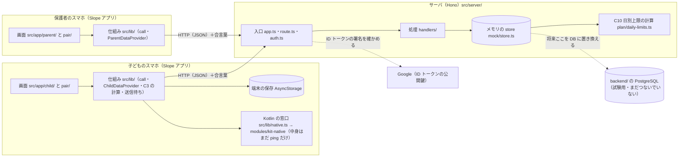
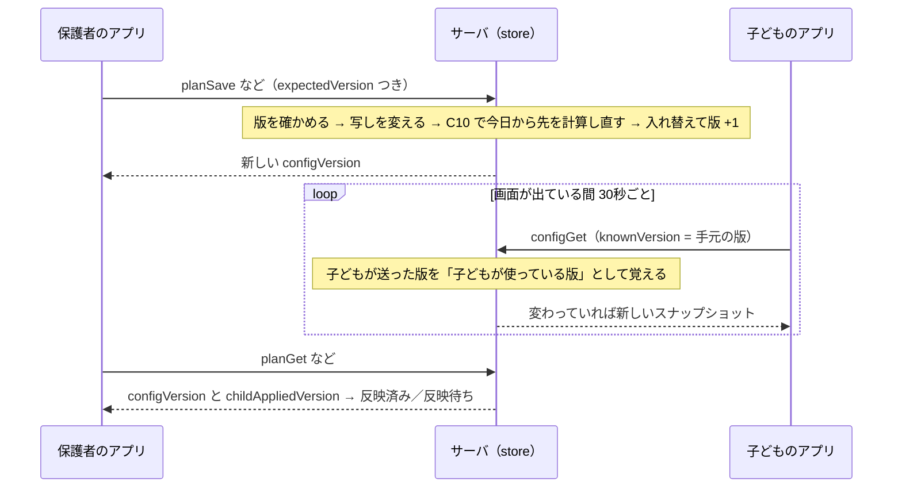
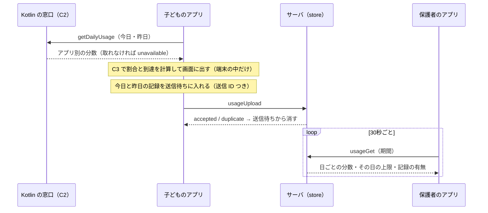

# 全体の作り（アーキテクチャ）

Slope がどんな部品でできていて、データがどこからどこへ流れるか、どんな約束で作っているかをまとめます。
言葉が分からないときは [README.md の言葉の表](README.md#言葉の表) を見てください。

## 1. 全体の構成図

| 部分 | 何をするか | 主なファイル |
|---|---|---|
| 端末のアプリ | 画面を出し、サーバと通信する。保護者用・子ども用は同じアプリで、役割によって出す画面が変わる | `src/app/`・`src/components/`・`src/lib/` |
| Kotlin の窓口 | Android だけでできること（C2 使用時間の取得・C4 制限画面）を呼ぶ入口。**型と仮の動きだけで、Kotlin の中身はまだない**（`ping` だけ） | `contracts/native.ts`・`src/lib/native.ts`・`modules/kit-native/` |
| Hono のサーバ | 窓口（API）を受け、ログインと権限を確かめ、データを保存し、上限を計算する | `src/server/` |
| メモリの store | サーバのデータの置き場。**今はメモリの上だけ**で、サーバを止めると消える。状態は持つので、2台の端末で紐づけ〜表示まで通せる | `src/server/mock/store.ts` |
| DB | 試験用の PostgreSQL の表の設計。**今のサーバはまだ使っていない** | `backend/` |
| Google | 本物のログインのときだけ。サーバは Google の公開鍵で ID トークンの署名を確かめる | `src/server/auth/google.ts`・`src/lib/google.ts` |

### 本番と手元

- **本番は Vercel の Hono** です。リポジトリ直下の `server.ts` が `src/server/app.ts` をそのまま公開します（Vercel は直下の `server.ts` の default export を使う）。
- **手元**では `npm run dev:server`（`src/server/dev.ts`）が `http://localhost:3000` にサーバを立てます。同じネットワークのすべてのアドレスで待つので、実機やエミュレータからも届きます。
- **`backend/`** は試験用の PostgreSQL（Docker Compose でも立てられる）と Drizzle の表の設計です。独立した npm のプロジェクトで、ルートの型の検査・整形の検査（`npm run check`）からは外してあります（`tsconfig.json`・`biome.json` の `backend` の除外）。
- 注意: 今のサーバはデータを**プロセスのメモリ**に持ちます。`src/server/db/index.ts` のコメントのとおり、Vercel では関数のメモリにデータを置いても残らない（呼ぶたびに別のインスタンスになりうる）ので、**DB につなぐまでは手元の PC のサーバで試します**。

## 2. フォルダごとの役割

| フォルダ・ファイル | 役割 |
|---|---|
| `contracts/` | **契約（型）**。アプリとサーバの両方がここだけを見てつながる。`api.ts`（API の表）・`schemas.ts`（データの形）・`errors.ts`（エラーの形と文言）・`dates.ts`（日付の計算）・`fixtures.ts`（MOCK の人と見本のデータ）・`native.ts`（Kotlin の窓口の型）・`tokens.ts`（色・余白・文字の大きさ） |
| `src/server/app.ts` | サーバの入口。`contracts/api.ts` の表をそのまま Hono の道につなぐ（道を手書きしない） |
| `src/server/route.ts` | API 1本ぶんの処理の枠（`handle()`）。ログインの確認 → 入力の検査 → 子どもの範囲の確認 → 処理 → 出力の検査、の順に必ず通す |
| `src/server/auth.ts`・`auth/google.ts` | 合言葉から「呼んだ人」を決める・役割を確かめる・子どもの範囲を確かめる。Google の ID トークンの検証 |
| `src/server/handlers/` | API 1本につき1ファイル（名前は API 名と同じ）。中身はほぼ store を呼ぶだけ |
| `src/server/mock/store.ts` | データの置き場（`MemoryStore`）。ログイン・QR・家族・計画・日程・日別上限・対象外アプリ・利用記録・版 |
| `src/server/plan/daily-limits.ts` | C10 の日別上限の計算（純粋な関数） |
| `src/server/env.ts`・`errors.ts`・`dev.ts` | 環境変数の読み取り・サーバのエラー（`AppError`）・手元用のサーバ |
| `src/server/db/` | ひな型から残っている DB の接続口（Neon / PGlite）と例の表（`rules`・`usage`）。**今の API は使っていない**（`tests/server/db.test.ts` だけが使う） |
| `src/lib/` | アプリ側の仕組み。`api.ts`（通信）・`session.tsx`（ログイン状態）・`google.ts`（Google ログイン）・`storage.ts`（端末の保存）・`config-cache.ts`（C7）・`usage-calc.ts`（C3）・`usage-outbox.ts`（C8）・`native.ts`（Kotlin の窓口）・`polling.ts`（30秒ごとの取得）・`flow.tsx`（画面の間の受け渡し）・`child-data.tsx`・`parent-data.tsx`（子ども用・保護者用のデータの共有） |
| `src/components/` | 共通の部品（`Screen`・`Card`・`Button`・`StateView` など）。`child/`・`pair/`・`parent/`・`schedule/` は機能ごとの部品と、画面の判断をまとめた純粋な関数 |
| `src/app/` | 画面（Expo Router。ファイルの場所がそのまま道になる）。`index.tsx`（入口）・`login.tsx`・`pair/`・`child/`・`parent/` |
| `modules/kit-native/` | Kotlin のモジュール（Expo Modules）。今は `ping` だけ |
| `tests/` | Vitest のテスト。フォルダの分け方は [development.md](development.md#テストの構成) |
| `backend/` | 試験用の DB の表の設計（別のプロジェクト） |
| `server.ts` | Vercel の入口（`src/server/app.ts` を公開するだけ） |
| `app.json` | Expo の設定。名前 `Slope`・scheme `slope`・Android だけ・使う部品（カメラ・日付の選択・Google ログイン） |
| `.env.example` | 手元用の環境変数の見本（[development.md の「環境変数の項目」](development.md#環境変数の項目)） |
| `android/`・`tmp/` | Git に入れない（`android/` は `npx expo prebuild` / `npm run android` が作り直す生成物） |

コードの中では `@/…` が `src/…`、`@contracts/…` が `contracts/…` を指します（`tsconfig.json` の `paths`）。

## 3. データの流れ

### 保護者が設定を変えて、子どものスマホに届くまで

### 子どもが使った時間が、保護者の画面に出るまで

## 4. 設計の原則と、守っている場所

| 原則 | なぜ | コードのどこで守っているか |
|---|---|---|
| **割合・到達の判定は子どもの端末の中で行う** | 電波がなくても判定できるように。親の画面で設定を変えても、過去の記録を計算し直さないように | C3 は `src/lib/usage-calc.ts` の `calcUsage`。判定の値は `src/lib/child-data.tsx` が `native.saveRestriction` で Kotlin に渡す（Kotlin は保存した値でオフラインでも判定する予定）。親の画面は端末が送った `restrictedMinutes`（制限対象の合計）をそのまま使う |
| **親の権限はサーバで確かめる（画面で隠すだけにしない）** | 子どもが保護者の操作をする・他人の子どもを見る、を防ぐ（AC-04・AC-13） | API ごとの `auth` は `contracts/api.ts`。毎回 `src/server/route.ts` の `prepare` が `auth.ts` の `authorize`（役割）と `checkChildAccess`（子どもは自分だけ・保護者は連携済みの子どもだけ・紐づけ前は何も扱えない）を呼ぶ。テストは `tests/verify/security.test.ts`・`tests/server/api.test.ts` |
| **画面はサーバと `call()` だけで話す** | 道（path）の打ち間違い・合言葉の付け忘れ・エラーの形のばらつきを防ぐ | `src/lib/api.ts` の `call()` / `stream()`。`fetch` はここにしかない。道は `contracts/api.ts` の表から引く。サーバ側も `src/server/app.ts` が同じ表から道を作り、表に処理が足りないと型の検査で落ちる |
| **取れない値を 0 にしない** | 「0 分使った」「0 分まで」と「分からない」を取り違えると、子どもを誤って止めたり、親が誤解したりする | 使用時間は `NativeUsageResult` の `unavailable`・`permission_denied`（`contracts/native.ts`）。C3 は `UsageCalc` の状態を分ける。設定は `ConfigState` の `unavailable`（`config-cache.ts`）。親の実績は `UsageDay.recorded: false`。画面は `StateView`・`Gauge`（`null` は「--」）・件数は出さない（`countText`・`testCountLabel`） |
| **「制限なし」「上限未設定」「0 分」を型で分ける** | 3つとも「制限しない／できない」ように見えるが意味が違う（Q7） | `DayLimit`・`DailyLimit` の `kind`（`contracts/schemas.ts`）、`LimitInput`（`usage-calc.ts`）、`NativeRestriction.limit`（`contracts/native.ts`）。詳しくは [data.md の 2章](data.md) |
| **保存はサーバの確定を待ってから「成功」と出す** | 押しただけで成功と出すと、届かなかったときに嘘になる（MVP_SPEC 5.3） | `Button` の `loading` で二重に押せない。日程は `PeriodEditor`、計画は `plan.tsx`（`saveConfirmation`）、紐づけは `linked` を見るまで成功を出さない（`child-flow.ts`・`parent-flow.ts`） |
| **入口と出口の両方を契約で検査する** | 形の違うデータで処理が進まないように | サーバは `route.ts` で入力（400）と出力（500 = サーバの不具合）を検査。アプリは `call()` で応答を検査 |
| **保存と C10 の計算は1回の処理（全部うまくいったときだけ成功）** | 途中で失敗して、日程だけ変わって上限が古い、を起こさない（Q5） | `store.ts` の `mutate`（写しを作って変える → `recalculate` → 入れ替えて版 +1）。失敗したら何も変えない |
| **版で取り違えを防ぐ** | 別の端末が先に変えたのに上書きする・古い設定と新しい設定を混ぜる、を防ぐ（Q6） | 書く API は `expectedVersion` を受け、ずれていたら `conflict`（`store.ts` の `mutate`）。端末は版の違う組を混ぜない（`config-cache.ts` の `reconcileConfig`） |
| **「今日」は日本時間で1か所だけで出す** | 端末とサーバで日付がずれないように（Q3） | `contracts/dates.ts` の `todayString`（UTC+9・0時区切り） |
| **計算・判断は画面から切り離した純粋な関数にしてテストする** | 画面を動かさなくても正しさを確かめられるように | C10 `daily-limits.ts`、C3 `usage-calc.ts`、C7 `reconcileConfig`、C8 `createUsageOutbox`、紐づけの表示 `child-flow.ts`・`parent-flow.ts`・`link-check.ts`、画面の文言 `child-view.ts`・`schedule/logic.ts`・`parent/*.ts` |
| **見た目は `contracts/tokens.ts` の名前だけ** | 色や余白をそろえ、あとで変えやすくする | 画面は `StyleSheet.create` の中で `tokens.color.primary` のように使う。`style={{…}}` と色コードの直書きはない（自動の検査はなく、書く人が守る約束） |
| **Android 固有の処理は窓口を通す** | Kotlin がない環境（テスト・Expo Go）でも落ちない。将来 iOS に差し替えられる | `src/lib/native.ts` が `KitNative` を名前で探し、なければ安全な既定値（権限なし・使用時間は取得不可・制限画面は出せない）を返す |

## 5. 端末に残すもの

`src/lib/storage.ts` の `storageKeys` にだけキーを書きます（アプリを閉じても消えない。AsyncStorage）。

| キー | 中身 | 消えるとき |
|---|---|---|
| `slope.session` | ログインした人（合言葉を含む `Session`） | ログアウト・サーバが 401 を返したとき |
| `slope.config.<childId>` | C7 の最後に正常だったスナップショット | 今のコードでは消す処理を呼んでいない（`configCache.clear` はあるが使われていない） |
| `slope.usage-outbox` | C8 の送信待ち | 送れた分だけ消える。ログアウトしても消さない（子どもの記録を失わないため） |
| `slope.mock-device-id` | MOCK の「はじめての人」をこの端末だけの人にする番号 | 消さない |

読むときは Zod で形を確かめ、壊れていたら「ない」として扱います（`readJson`）。

## 6. まだ無いもの

- **Kotlin の中身**（C2 の使用時間の取得・C4 の制限画面・監視の開始）。窓口（`contracts/native.ts`）と仮の動きだけ。開発中は `EXPO_PUBLIC_FAKE_USAGE=1` で仮の使用時間を出せる。
- **DB への保存**。サーバはメモリの store。
- **ウィジェット（C5）・ダークテーマ**。MVP の後。
- **画面が出ていないときの予備の取得（15分ごと）**。`src/lib/polling.ts` の `TODO(未決)`。今は画面が前に出ている間だけ取りに行く。
