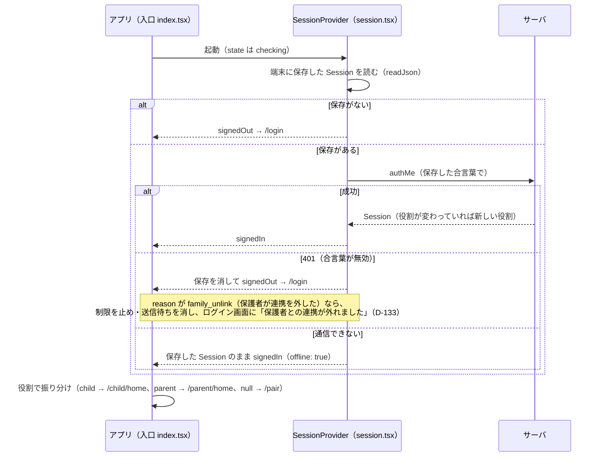
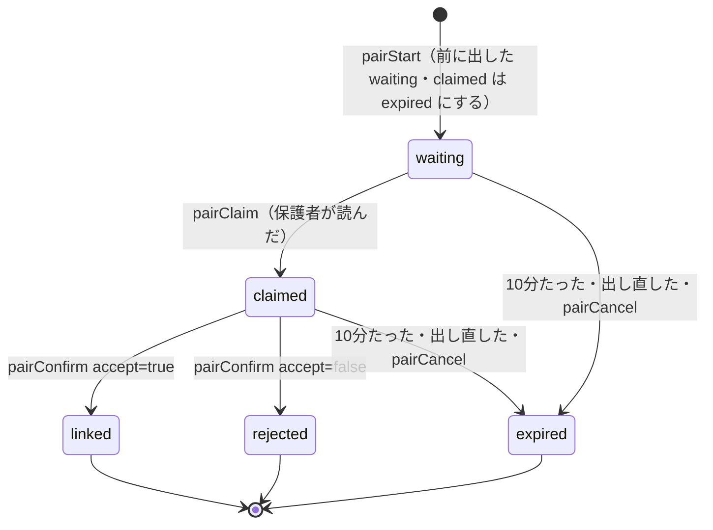
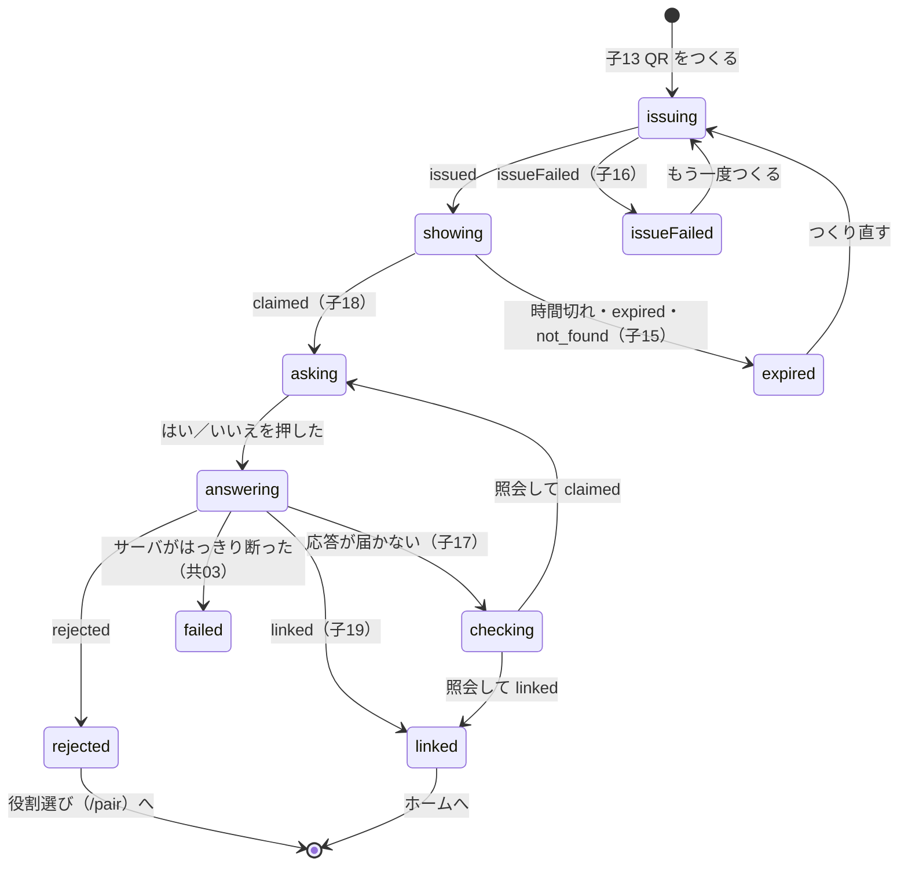
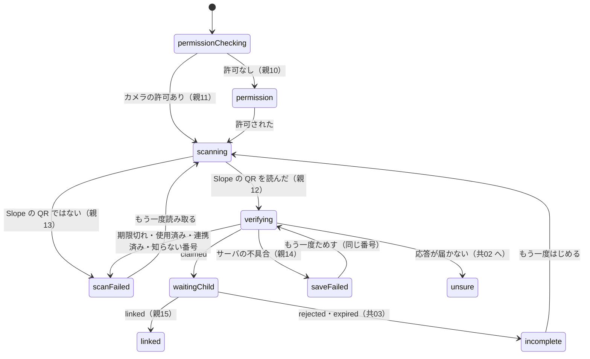
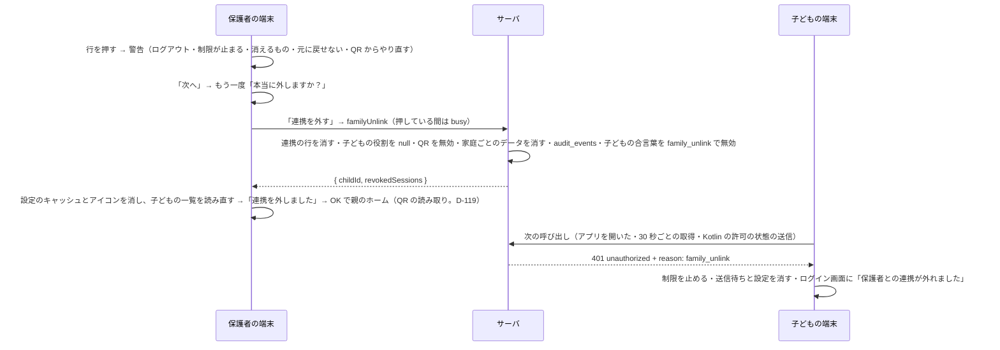
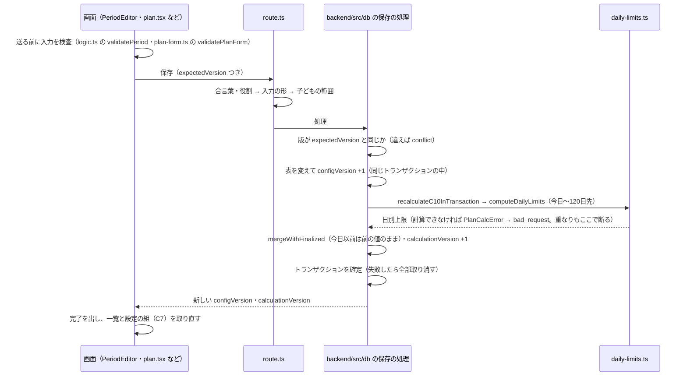
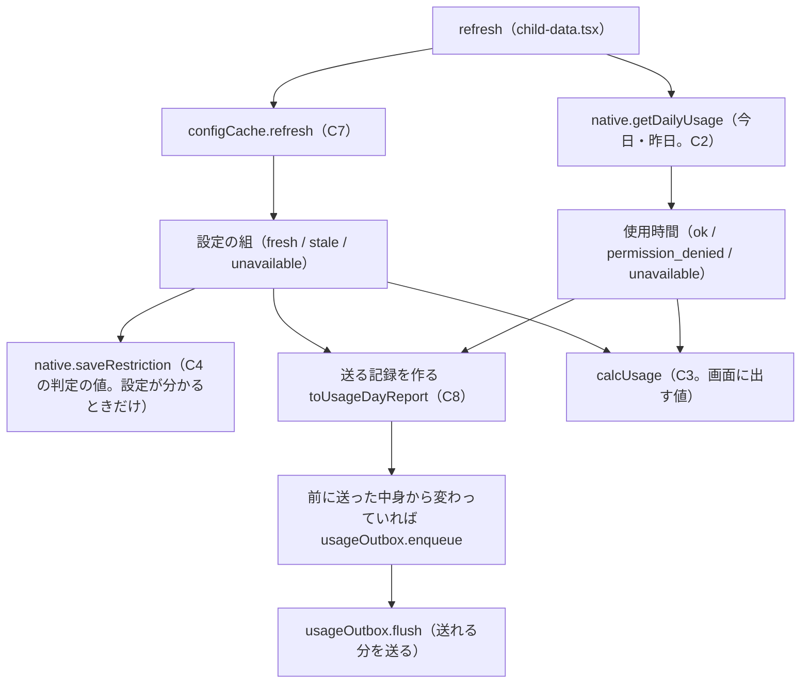
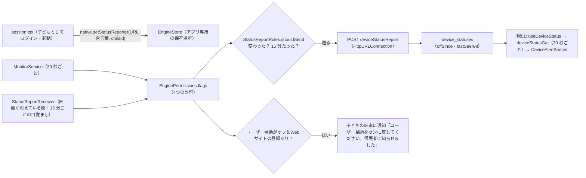

# 主な流れ（順番に）

アプリを起動してから、保護者が子どもの使った時間を見るまでを、段階ごとに説明します。
各段階に「どのファイルのどの関数が担当か」を書きました。API の細かい形は [api.md](api.md)、データの形は [data.md](data.md)、画面は [screens.md](screens.md) を見てください。

目次:

1. 起動とログイン（C1）
2. 役割選び
3. QR の紐づけ（C1）
4. 通常上限を決める
5. 計画・テスト期間・空白期間の保存と C10 の再計算
6. 子どもの端末が設定を取りに行く（C7）
7. 使用時間の計測（C2）と割合（C3）
8. 上限に届いたとき（C4）
9. 利用記録の送信（C8）
10. 保護者の画面（C6）
11. 制限対象外アプリ（C9）と反映済み／反映待ち
12. 制限する Web サイト（D-111）

---

## 1. 起動とログイン（C1）



| 段階 | 担当 |
|---|---|
| 全体を包む | `src/app/_layout.tsx`（`SessionProvider` と `FlowProvider` で包む） |
| 起動時の確認 | `src/lib/session.tsx` の `verify`（`authMe` を呼ぶ。401 なら `forget`、通信できなければ `offline: true`） |
| 振り分け | `src/app/index.tsx`（`checking` は読み込み中、`signedOut` は `/login`、役割で `/child/home`・`/parent/home`・`/pair`） |
| ログイン画面 | `src/app/login.tsx`（子08・子09） |
| Google か MOCK か | `src/lib/google.ts` の `googleSignInEnabled`（`EXPO_PUBLIC_GOOGLE_WEB_CLIENT_ID` があれば本物） |
| 本物の Google | `signInWithGoogle` → ID トークン → `useSession().signIn(idToken)` → `call("authGoogle")` |
| MOCK | `mockLoginChoices` の3つのボタン（保護者・子ども・はじめての人）。「はじめての人」は端末ごとの番号つき（`mock-new-<端末の番号>`） |
| サーバの確認 | `src/server/handlers/authGoogle.ts`：`mock-` で始まれば `MOCK=1` のときだけ `src/server/auth.ts` の `signInMock`（Vercel の本番では `MOCK=1` を無視する）。それ以外は `auth/google.ts` の `verifyGoogleIdToken`（署名・発行元・宛先・期限）→ `auth.ts` の `signInGoogle`（初めての人は登録。役割は `null`） |
| 合言葉の保存 | `session.tsx` の `adopt`：`setSessionToken`（以後の `call()` に付く）と端末への保存 |
| 使っている途中の 401 | `src/lib/api.ts` が `setUnauthorizedHandler` で登録された関数にサーバの返事を渡す → `session-core.ts` の `expire` がログアウト状態にし、ログイン画面に「ログインの期限が切れました」の帯（`login-view.ts` の `loginNotice`） |
| 連携が外れた 401（D-133） | 401 の本文に `reason: "family_unlink"` があれば、ログイン画面の帯はサーバの文「保護者との連携が外れました ／ また使うときは、ログインしてから保護者と QR でつなぎ直してください」。ログアウト状態にしたあとで、`session.tsx` の `clearUnlinked`: `native.clearLocalData()`（Kotlin の監視を止め、判定の値・ウィジェットを消す）と `clearLocalDataFor(userId)`（設定のキャッシュ・その子どもの送信待ち・送ったアプリの一覧）。起動時の確認（`verify`）の 401 も同じ。理由のない 401 ではどちらもしない |
| 失敗 | 子09 のダイアログ。Google で「やめた」はエラーにしない（`login-view.ts` の `googleOutcome`） |
| ログアウト | 設定の「ログアウト」→ 確認（`src/components/LogoutListItem.tsx`）→ `session.tsx` の `signOut`：合言葉をサーバでも無効にする（`sign-out.ts` の `revokeServerSession` → `authSignOut`。5 秒まで待ち、失敗しても進める）→ Google のログインを外す → `src/lib/sign-out.ts` の `clearLocalDataFor(userId)`（設定のキャッシュを全部と、その人の送信待ちを消す）→ 合言葉を消す → 入口 |

合言葉の期限は「最後に使ってから30日（使うたびに延長）」です（`src/server/auth.ts` の `SESSION_IDLE_MS`・`findSession`）。合言葉は DB に SHA-256 のハッシュでだけ残します（`src/server/auth/digest.ts`）。
`authSignOut` は本文なしなら呼んだ端末の合言葉だけ、`{ "otherDevices": true }` なら同じ人のほかの端末の合言葉をすべて無効にします（端末をなくしたとき用。今のアプリは本文なしだけを使う。`auth.ts` の `signOut`）。
合言葉の期限切れ（401）のときは合言葉だけを消し、設定のキャッシュと送信待ちは残します（同じ人がログインし直して、残った記録を送れるように）。端末の制限（Kotlin の監視）も止めません（子どもが合言葉の期限切れを待つだけで制限から逃げられないように）。
保護者に連携を外された 401（`reason: "family_unlink"`）のときだけは、ログアウトと同じく制限を止め、送信待ちも消します（残すと、次に紐づけた保護者へ前の家庭の時期の記録が送られるため。セキュリティ検査 F-2 の残り。D-133）。

## 2. 役割選び

ログインしただけでは役割は `null` です。`/pair`（`src/app/pair/index.tsx`）に来ます（Q1）。

1. 開いたらすぐ `call("linkStatus")` で D2（家族のつながり）を照会する（15秒で時間切れ）。
2. 判断は `src/components/pair/link-check.ts` の `linkCheckView("check", …)`:
   - 照会できない → **共01**「連携状態を取得できない」（`LinkUnknown`）。未連携と決めつけず、QR へは進ませない。
   - 連携済み → `useSession().refresh()` で役割を取り直して入口へ。
   - 未連携 → 「保護者として使う」（→ `/pair/parent`）と「子どもとして使う」（→ `/pair/child`）を出す。
3. ここで選んだ役割は**端末の中だけ**です。サーバ上の役割は、次の QR の紐づけが確定したときに決まります。

## 3. QR の紐づけ（C1）

子どもが QR を出し、保護者が読み、子どもが「はい」で確定する **3段階** です（FigJam の2段階ではなく、作り直し前の設計に合わせた）。


### サーバの状態（`PairState`）



- 担当は `src/server/auth.ts` の `startPair`（`pairStart`）・`claimPair`（`pairClaim`）・`confirmPair`（`pairConfirm`）・`cancelPair`（`pairCancel`）・`readPairStatus`（`pairStatus`）。期限切れは「聞かれたときに確かめる」（`refreshExpiry`）。QR の番号は DB に SHA-256 のハッシュでだけ残す。
- QR は10分・1回だけ・出し直したら前の QR は無効（Q10）。`rejected` の QR も、もう読めない。
- `pairClaim` で断るもの: 子どもの端末（forbidden）、知らない番号（not_found）、期限切れ・使用済み・自分の QR・すでに誰かと連携済み（conflict）。not_found・conflict を同じ人が10分に10回くり返したら、その間は正しい番号でも `rate_limited`（429）。数は DB の表 `pair_claim_failures` に残す（Vercel のインスタンスはメモリを共有しないため）。成功したら数え直す（`PAIR_CLAIM_MAX_FAILURES`・`PAIR_CLAIM_WINDOW_MS`）。
- `pairConfirm` で断るもの: QR を出した子ども以外（forbidden）、期限切れ・まだ読まれていない・役割が合わない・その間に別の相手と連携した（conflict）。
- `pairCancel`（子どもの「やめる」）: `waiting`・`claimed` の QR を `expired` にする（保護者が読んだ後でも、子どもが「はい」を押す前なら取り消せる）。`expired`・`rejected` はそのまま返す（何度呼んでも同じ）。もう `linked` なら conflict。QR を出した子ども以外は forbidden（関わっていない人は not_found）。
- 親1人↔子1人（Q2）: すでに連携している人は QR を出せない・読めない・確定できない（`oneToOne` の conflict）。
- `familyUnlink`（保護者だけ。`{ childId }`）: 連携を外し、子どもの合言葉をすべて無効にし、子どもの役割を `null` に戻し、子どもの出しかけの QR を `expired` にする（`auth.ts` の `unlinkChild`）。応答は `{ childId, revokedSessions }`。同じトランザクションで、子どもの家庭ごとのデータ（利用記録・日別上限・計画・通常上限・テスト期間・空白期間・対象外アプリ・Web サイト・アプリ一覧とアイコン・端末の許可の状態）を消し、設定の版を 1 上げ（0 に戻さない。端末が前の版より小さい版を「古い」と見ないように）、誰が・いつ・どの子どもを外したかを `audit_events` に1行残す（`backend/src/db/family-unlink.ts`。D-101）。残すと、別の保護者と紐づけ直したときに前の家庭のデータが見えるため（F-2）。同じ保護者と紐づけ直しても、設定は最初から入れ直し。子どもの合言葉は理由 `family_unlink` で無効にする（`user_sessions.revoked_reason`。D-133）。画面は下の「子どもとの連携を外す」。
- 回数の上限（D-131）: `pairStart` は1人1分に5回、`authGoogle` は同じ IP から1分に20回・同じ人から1分に10回まで。こえたら `rate_limited`（429）。数は DB の表 `rate_limit_hits` に残す（`src/server/rate-limit.ts`）。
- 確定（`linked`）のとき、QR を出すときに入れた呼び名（`PairStart.name`。省けば Google のアカウント名）を子どもの名前として残す。以後の `familyGet`・`linkStatus`・`authMe` も同じ名前になる。

### 子どもの画面の移り変わり（`src/components/pair/child-flow.ts` の `childPairReducer`）



- `showing` の間に通信できないと「通信できません」の帯を足す（QR は出したまま）。
- 子14 の残り時間は端末の時計で数える（`localDeadline`・`remainingLabel`）。端末の時計がずれて期限がおかしく見えるときは「受け取ってから10分」にする。
- 進み具合は `PAIR_POLL_MS`（3秒）ごとに `pairStatus` で聞く（`shouldPoll` が true の間だけ）。
- 「やめる」は、出した QR を `call("pairCancel")` で取り消してから役割選びに戻る（以後その QR は読めない）。取り消しの応答は 3 秒だけ待ち（`CANCEL_TIMEOUT_MS`）、取り消せなくても画面は戻る（子どもが「はい」を押さない限りつながらず、QR も10分で切れるため）。QR をまだ受け取っていない（つくっている途中）なら送らない。
- 「はい」の応答が届かない（通信・時間切れ・サーバの不具合）ときは、成功とも失敗とも言わず **子17** で照会を続ける（MVP_SPEC 4.1）。

### 保護者の画面の移り変わり（`src/components/pair/parent-flow.ts` の `parentPairReducer`）



- 読んだ文字列は送る前に形を確かめる（`qrCodeOf`。英数字と `-` `_` の 8〜128 文字）。URL など Slope 以外の QR はサーバに送らず親13 にする。
- `waitingChild`（子どもの「はい」待ち）は Figma にない表示（`pair/parent.tsx` の `TODO(未決)`）。
- `unsure` になったら `/pair/status?reason=unsure&role=parent` へ移る。

### 失敗したとき（共01〜共03）

`src/app/pair/status.tsx` と `link-check.ts` の `linkCheckView("unsure", …)`:

| 照会の結果 | 出すもの |
|---|---|
| まだ照会していない | **共02**「連携結果が未確定」（押したら照会） |
| 照会できない | 共02 のまま（不明。失敗と言わない） |
| `linked` | 役割を取り直して入口へ（成功していた） |
| `unlinked` | **共03**「まだつながっていません」→「もう一度はじめる」は同じ役割の紐づけへ（`restartHref`） |

### つながった後

- 子ども: 子19「ホームへ」→ `refresh()`（役割が `child` になる）→ 入口 → `/child/home`。
- 保護者: 親15「1日の上限を決める」→ `refresh()`（役割が `parent`）→ `/pair/usual-limit`。つながった子どもは `flow.tsx` の `setChild` で次の画面に渡す。
- サーバは `pairConfirm` で子どもの設定の器（版 0・すべて空）を作る（`configFor`）。

### 子どもとの連携を外す（D-133）

保護者が親04 設定の「子どもとの連携を外す」（ログアウトの上の赤い行。行の2行目に子どもの名前）から外します。Figma にない画面なので、親07 ログアウト確認・日程の削除の確認と同じ形のダイアログです。



| 段階 | 担当 |
|---|---|
| 行とダイアログ | `src/components/parent/UnlinkChildItem.tsx`（`src/app/parent/settings.tsx` がログアウトの上に置く。子どもがいなければ行を出さない） |
| 二段階の分かれ道と文 | `src/components/parent/unlink.ts` の `unlinkReducer`・`unlinkText`・`UNLINK_EFFECTS`。警告 →「次へ」→ 確かめ →「連携を外す」の2回押して、はじめて送る。どの段でもキャンセル（左）・戻るで閉じる。送っている間は閉じない |
| 失敗 | ダイアログを閉じて行の上に `ErrorBanner`（`unlinkFailure`）。もう外れていた（not_found）・403 は子どもの一覧を読み直し、「もう一度」は出さない。通信できない・時間切れは読み直して「もう一度」も出す（サーバでは外れていることがあるため）。429・503 などはサーバの文のまま「もう一度」（確かめの段からやり直す） |
| サーバ | `src/server/auth.ts` の `unlinkChild`（上の `familyUnlink`）。子どもの合言葉は理由 `family_unlink` で無効（`user_sessions.revoked_reason`） |
| 子どもの端末（アプリ） | `src/lib/session-core.ts` の `expire`・`verify`（上の 1章「連携が外れた 401」） |
| 子どもの端末（Kotlin） | 許可の状態の送信（`StatusReporter`）が 401 + `family_unlink` を受けたら、アプリを開いていなくても `LocalData.clear`（ログアウトと同じ。監視を止めて端末の値を消す）。送っている間に JS が新しい合言葉を渡していたら消さない |

## 4. 通常上限を決める

紐づけの直後に、保護者が「テストがない日の1日の上限」を決めます（Q7）。画面は `src/app/pair/usual-limit.tsx`（Figma にない。下部タブなし）。

1. 子どもは `flow` の `child`。なければ `call("familyGet")` の1人目。
2. `call("planGet")` で今の版（`configVersion`）と、決めてあれば今の通常上限を取る。
3. 入力は「時間」と「分」。`src/components/pair/usual-limit-input.ts` の `parseUsualLimit`（全角の数字も可・片方だけなら他方は 0・0〜1440 分）。
4. 「決める」→ `call("usualLimitSave", { childId, expectedVersion, usualLimitMinutes })`。サーバは保存と C10 の再計算を終えてから返す。
5. 成功 → `refresh()` → 入口 → `/parent/home`。版がずれていた（conflict）→ 入力を残して版を取り直す。
6. 「あとで決める」→ 入口へ。その間、計画やテストがない日は「上限未設定」（0 分とも制限なしとも違う）。親01 には「1日の上限がまだ決まっていません」の帯と「1日の上限を決める」ボタンが出る。

## 5. 計画・テスト期間・空白期間の保存と C10 の再計算

| 何を | 誰が | 画面 | API |
|---|---|---|---|
| 通常上限 | 保護者 | `pair/usual-limit.tsx`（親02 でも変えられる） | `usualLimitSave` |
| 計画（開始日・S・G、通常上限も一緒に） | 保護者 | `parent/plan.tsx`（親02） | `planSave` |
| テスト期間 | 親子どちらも（Q11） | 子03・子05・子10（`child/schedule-*.tsx`）、親05（`parent/schedules.tsx`） | `testPeriodCreate`・`Update`・`Delete` |
| 空白期間 | 保護者だけ | `parent/blank-periods.tsx`（親02 から入る） | `blankPeriodCreate`・`Update`・`Delete` |



- 担当: `backend/src/db/*.ts` の保存の処理（`test-periods.ts`・`blank-periods.ts`・`plan-settings.ts`。全体を1回の DB のトランザクションで行う）と `backend/src/db/c10-recalculate.ts` の `recalculateC10InTransaction`（C10）。権限の確かめと入口は `src/server/services/*.ts`。途中で失敗したら何も変えない（前の正式な版を保つ。Q5・AC-07）。
- C10 の式と例は [data.md の 4章](data.md) にあります。
- **明日から先だけ**を計算し直し、今日以前の日別上限は変えません（今日の値がまだなければ今日の分も作る。Q4・D-92。`mergeWithFinalized`）。
- 日別上限は保存した日から 120 日先まで作ります（`src/server/plan/daily-limits.ts` の `LIMIT_HORIZON_DAYS`）。設定を変えないまま日がたって、残りが 60 日（`LIMIT_TOPUP_MIN_DAYS`）を切ったら、次の `configGet` のときに今日から 120 日先まで作り足します（`backend/src/db/c10-recalculate.ts` の `topUpDailyLimits`。今日より前は変えない。設定の版と計算の版が 1 上がる）。
- まだ一度も日別上限を計算していない子どもの `configGet` は、`calculationVersion: 0`・日別上限なし（上限未設定）を返します（エラーにしない）。
- 計画の開始日は**今日以降**でないと保存できません（Q14。`src/server/services/plan-settings.ts` の `savePlanForCaller`）。デモの見本（`src/server/seed/demo.ts`）は API を通らずに DB の処理を直接呼ぶので、14日前の開始日を入れられる。
- 対象外アプリの保存（C9）・制限する Web サイトの保存（D-111）は C10 を計算し直しませんが、版は上がります。
- 画面側:
  - 日程: `src/components/schedule/PeriodEditor.tsx`（保存は `actions.ts` の `savePeriod`・`deletePeriod`）。**変更・削除**は入力を始めた時点の版を送り、**登録**は最新の版を送る（30秒ごとの取り直しで最新の版を送ると、ほかの端末の変更を黙って上書きしてしまうため）。失敗の出し分けは `logic.ts`（conflict → 読み込み直し・bad_request → 入力を残してサーバの文・not_found → 一覧へ・通信 → もう一度）。
  - 計画: `src/app/parent/plan.tsx` の `save`。保存の応答のあと、設定の組を取り直して新しい日別上限がそろってから「計画を作りました」（`plan-form.ts` の `saveConfirmation`）。
  - 保存のあと、子どもの画面は `useChildData().refresh()`、保護者の画面は `useParentData().refresh()` で設定の組を取り直す。

## 6. 子どもの端末が設定を取りに行く（C7）

子ども用の画面は `src/app/child/_layout.tsx` が `ChildDataProvider`（`src/lib/child-data.tsx`）で包みます。
`usePolling`（`src/lib/polling.ts`）が、**画面が出ている間 30秒ごと・画面を開いたとき・アプリが前面に戻ったとき**に `refresh` を呼びます（前の回が終わっていなければ飛ばす `singleFlight`）。

`refresh` の中身（どれかが失敗しても、ほかは続ける）:



C7 の決まり（`src/lib/config-cache.ts`）:

1. 起動直後は、端末に保存した組をすぐ出す（`load`。通信を待たない。理由 `not_checked` の stale だが、帯は出さない）。
2. `configGet` に手元の版を `knownVersion` として送る。サーバは、子どもが送った版を「子どもの端末が使っている版」（`childAppliedVersion`）として覚える（Q6）。そのあと日別上限の残りが少なければ作り足してから（5章）、版を比べて返す。
3. 応答の扱いは純粋な関数 `reconcileConfig`。まず応答の `epoch`（サーバの DB ごとに決まる値。D-109）を手元の組の epoch と比べる。違えば（手元に epoch のない古い保存分も「違う」）、手元の組はないものとして決める（版の大小は比べない。DB を作り直すと版は 0 から数え直すので）。同じなら版を比べる:

| 応答 | 判断 |
|---|---|
| `changed: false` で epoch も手元の版も同じ | `keep`（手元が最新） |
| `changed: false` だが手元にその版がない・epoch が違う | `refetch`（版を付けずに取り直す） |
| 別の子どもの組・同じ日付が2つある組 | 捨てる（`invalid`。epoch が違っても同じ） |
| epoch が違う組（版が手元より小さくても・同じでも） | 採用して epoch と一緒に端末に保存（`adopt`） |
| epoch が同じで手元より古い版 | 捨てる（`older_response`） |
| epoch が同じで同じ版なのに中身が違う（作った時刻だけの違いは同じとみなす） | 捨てる（`integrity`） |
| epoch が同じで新しい版 | 採用して端末に保存（`adopt`） |

   手元の組に epoch がなければ（epoch を足す前に保存した組）、`knownVersion` を送らない（どの DB の版か分からないので、中身つきで返してもらって置き換える）。採用した組は子どもの端末では Kotlin にも渡す（`native.saveRestriction`。毎回上書き）。
   組には制限する Web サイト（`blockedSites`。D-111）も入る。この項目を足す前に端末へ保存した組は、読むときに空（登録なし）として扱う（`ConfigSnapshot` の `.default([])`。同じ版の応答と食い違わない）。

4. 通信に失敗したら、最後に正常だった組を `stale`（最新でない可能性あり）で返す。手元にもなければ `unavailable`（取得不可。上限を 0 分として扱わない）。
5. 待っている間にほかの取得が新しい組を保存したかもしれないので、比べる前に読み直す（古い応答で上書きしない）。
6. 子どもの画面は stale のとき「最新でない可能性があります」の帯を出す（`child-view.ts` の `staleNotice`。`not_checked` のときは出さない）。

## 7. 使用時間の計測（C2）と割合（C3）

**C2（使用時間）**: `src/lib/native.ts` の `getDailyUsage(date)`。

- Kotlin（`modules/kit-native/android/src/main/java/dev/hackathon/kit/kitnative/engine/UsageReader.kt`）が、OS の使用イベント（`UsageStatsManager.queryEvents` の ACTIVITY_RESUMED／PAUSED／STOPPED・画面が消えた・電源断）を並べて、**日本時間 0:00〜24:00** に前面にいた時間をアプリごとに数える（`ForegroundTime.kt`）。OS の集計（`queryUsageStats`）は日の区切りがずれるので使わない。分は 0.1 分単位。
  - 数えないもの: ランチャー（ホーム画面）・Slope 自身・システムの画面。0.1 分未満のアプリは一覧に入れない。アプリ名は PackageManager から（引けなければパッケージ名）。
  - 取れない日: まだ来ていない日・6日より前の日（OS がイベントを残していない）は `unavailable`（0 分にしない）。
- Kotlin がないとき（Expo Go・テスト）: `EXPO_PUBLIC_FAKE_USAGE=1`（または `setFakeUsage(true)`）なら仮の値（`contracts/fixtures.ts` の `demoAppMinutes` を時刻に合わせて増やしたもの）。そうでなければ `{ status: "unavailable" }`（0 分にしない）。
- 「使用状況へのアクセス」が許可されていなければ `permission_denied`（OS は権限がないと空を返すので、先に権限を確かめる）。画面は使用状況へのアクセスの設定を開く案内を出す（`native.openPermissionSettings("usageAccess")`）。
- 今日の分を読んだときは、ウィジェット用のまとめ（下の「端末に残すもの（Kotlin）」の `today_usage`）も書き直す。

**C3（割合と到達）**: `src/lib/usage-calc.ts` の `calcUsage`。`child-data.tsx` が `useMemo` で計算して `calc` として配る。

1. 使用時間が取れない（`permission_denied`・`unavailable`）→ その状態を先に返す（上限があっても 0 分として計算しない）。
2. その日の上限を `limitForDate(snapshot, date)` で取り出す: 組がない＝`unknown`、日付がない＝`unset`（未設定）、空白期間＝`unlimited`、それ以外＝`set`。
3. 制限対象の合計 = 対象外アプリ（C9）と必須例外（`ESSENTIAL_PACKAGES`。電話など）を除いた分の合計（`restrictedMinutes`）。
4. 上限 0 分 → 到達・表示 100%・残り 0%（0 で割らない）。
5. それ以外 → 実際の使用率 = 使用 ÷ 上限 × 100（100 を超えてもそのまま持つ）。到達は実際の分数で決める（「使用 ≥ 上限」。Q17 は未決で仮）。表示は 0〜100 に収めて四捨五入し、**到達していなければ最大 99、到達したら 100**（99.5% 以上が四捨五入で 100 になり「100% なのにまだ使える」と見えないように。表示が 100 ⇔ 到達）。残り％ = max(0, 100 − 表示)。

画面（`src/components/child/child-view.ts` の `usageView`）は、割合が出せない状態（上限未設定・制限なし・権限なし・取得不可）では数字を出さず、それぞれの文を出します。子どもには分数を主に見せません（割合が主。MVP_SPEC 4.2）。
子02 の今週の棒グラフは、過去の日の端末の記録（`native.getDailyUsage(日付)`）とその日の日別上限から、同じ計算で割合を出します（`dayCalc`・`weekBars`）。

## 8. 上限に届いたとき（C4）

- 判定の値: `child-data.tsx` の `refresh` が毎回 `native.saveRestriction(toNativeRestriction(snapshot, 今日))`（`src/lib/usage-calc.ts`）で Kotlin に渡す。中身は `{ date, limit, upcoming（翌日から14日分の上限）, excludedPackages, essentialPackages, learningPackages, blockedSites（制限する Web サイト。12章）, configVersion, testPeriods（ウィジェット用） }`。`learningPackages` は子11 の「お勧めアプリ」と同じ1つの一覧（`src/lib/usage-calc.ts` の `LEARNING_PACKAGES`。今は仮に Google Classroom・Duolingo）。`limit` は `limited`／`unlimited`／`unset` を分けて渡す。設定が分からないときは渡さない（前の値で判定を続ける）。
- **Kotlin の監視**（`engine/MonitorService.kt`。Foreground Service・種類は specialUse・通知「Slope が使用時間を見守っています」）:
  - 始まる: 子どもの画面が出たとき（ログイン後）と、設定を取れたとき（`native.startEngine()`）。端末の再起動・Slope の更新のあと（`BootReceiver`。監視を始めたことがあり、判定の値が保存してあるときだけ）。
  - 止まる: ログアウト（`session.tsx` の `signOut` → `native.clearLocalData()`。監視を止め、Kotlin の保存とウィジェットの値を消す）。
  - 30 秒ごと（到達している間は 15 秒ごと・画面がついたときはすぐ）に、今日の使用時間を読み、**C3 と同じ規則**（対象外・必須例外を除く・上限 0 分は到達・制限なし／未設定／ルールのない日は到達しない・「使用 ≥ 上限」で到達）で判定する（`LimitRules.kt`）。日付が変わったら `upcoming` から今日の上限を取り出す（Slope を開かなくても次の日を判定できる）。
  - 到達していて、前面のアプリが Slope・ランチャー・システムの画面・対象外アプリ・必須例外のどれでもなく、Slope の画面が前に出ていなければ、子11 を前に出す（`LimitPrompt.kt`）:
    - 「他のアプリの上に表示」が許可されていれば `slope://child/limit-reached` の Activity を起動する（Android 10 以降の裏からの起動の制限の例外）。
    - なければ優先度の高い通知（全画面の intent つき。Android 14 以降は全画面の許可がなければ上から出る通知）。押すと子11 が開く。
    - 同じアプリには 60 秒、どのアプリにも前の案内から 10 秒あける（`PromptThrottle`。出し続けて端末が使えなくならないように。`TODO(未決)` 実機で決める）。
- **今の画面の動き**: 子01 ホーム（`src/app/child/home.tsx`）が見えている間に `calc` が到達になったら、その日に1回だけ `native.showLimitReached()` を呼び（Kotlin がなければ何もしない）、子11（`/child/limit-reached`）へ進む（`child-view.ts` の `shouldOpenLimitScreen`）。
- 子11（`src/app/child/limit-reached.tsx`）: 「今日のスマホの時間は終わりです。続きはあしたにしよう」・今日の使用量・次のテスト・「お勧めアプリはこちらです ›」（`LEARNING_PACKAGES` を上から順に `native.openApp` で試す。開けなければ案内のダイアログ）・「閉じる」。
- Android は他のアプリを無条件には止められません（MVP_SPEC 2章）。子11 は「案内」で、遮断は約束しない文にしています。
- 子01 ホームには、まだ許可していないもの（他のアプリの上に表示・通知・電池の最適化・ユーザー補助）を並べた「見守りのための許可」のカードを出す（`PermissionGuideCard`・`child-view.ts` の `permissionGuide`。Figma にない）。使用状況へのアクセスは「今日の使用量」のカードが案内する。ユーザー補助は、制限する Web サイトが1つ以上登録されているときだけ並ぶ（12章）。
- 上限に達したあと、ブラウザで保護者の登録した Web サイトを開いたときは、ブラウザを1つ前に戻してから子11 を出す（12章。ブラウザが対象外アプリでも止める）。

### 許可の見張りと親への通告（D-113）

子どもが設定の画面で「ユーザー補助」などの許可を勝手にオフにすると、C2・C4・Web サイトの制限が効かなくなります。Android ではこれらのスイッチだけを固定できない（Device Owner でも、止められるのは設定アプリ全体）ので、**変わったら保護者に知らせる** ことにしました（docs/decisions.md D-113）。



1. **送り先と合言葉を渡す**: `src/lib/session.tsx` が、ログインの状態が変わるたびに `src/lib/status-reporter.ts` の `statusReporterAction` で決めて、子どもとしてログインしていれば `native.setStatusReporter(apiUrl("deviceStatusReport"), 合言葉, 自分の userId)`、保護者・ログアウト・401 なら `native.clearStatusReporter()` を呼ぶ。Kotlin は `EngineStore`（`slope_engine` の `report_url`・`report_token`・`report_child_id`）に置く。ログアウトの `clearLocalData` でも消える。
2. **見張る**: `MonitorService` の見張り（30 秒ごと。画面がついたときはすぐ）が `EnginePermissions.flags`（使用状況へのアクセス・他のアプリの上に表示・通知・ユーザー補助。子01 の許可のカードと同じ判定）を読む。画面が消えて CPU が眠っている間は、見張りが止まるので、`AlarmManager` の目覚まし（`setAndAllowWhileIdle`。15 分ごと・端末の休止中でも鳴る）で `StatusReportReceiver` が同じことをする。
3. **送る**: `StatusReportRules.shouldSend` が「まだ送っていない・前に送った状態と違う・前に届いてから 15 分たった」なら送る。通信は見張りとは別のスレッドで、`HttpURLConnection`（つなぐ 5 秒・読む 4 秒）。本文は `childId`・許可ごとのオン/オフ・測った時刻だけ（使用時間・アプリ名・URL は送らない）。
   - 失敗（時間切れ・通信できない・5xx・408・429）: 黙って 1 分後にやり直す。ほかの 4xx（403 など）: 15 分待つ。
   - 401 で本文がサーバの `unauthorized`: 保存した合言葉を消して送るのをやめる（連携を外された・ログアウトされた）。Vercel の保護ページなど、ほかの 401 では消さない。
   - そのうち本文に `reason: "family_unlink"`（保護者が連携を外した）があれば、さらに監視を止めて端末に残した値を消す（`LocalData.clear`。ログアウトの `clearLocalData` と同じ。D-133）。アプリを開かなくても、生存報告（15 分ごと）か許可の変化で送ったときに制限が止まる。ほかの 401 では監視を止めない。
4. **保存する**: サーバ（`src/server/services/device-status.ts`・`backend/src/db/device-status.ts`）は合言葉の本人の行（`device_statuses`）に、許可ごとのオン/オフ・オフになった時刻（最初にオフと届いた報告の測った時刻）・最後に届いた時刻（サーバの時計）を保存する。遅れて届いた古い報告では状態を変えない。
5. **保護者に知らせる**: 親01 ホーム（`src/app/parent/home.tsx`）が `useDeviceStatus`（`src/components/parent/data.tsx`。`deviceStatusGet` を 30 秒ごと）で読み、帯の部品 `DeviceAlertBanner`（`src/components/parent/DeviceAlertBanner.tsx`。別の係が作る）に `status` と `hasBlockedSites` を渡す（[screens.md](screens.md) の親01）。最後に届いてから 30 分以上なら「連絡が取れていません」（アプリが消された・電源が切れた・通信がない可能性）。まだ一度も届いていない（古いアプリ）ときは何も出さない。
6. **子どもに催促する**: ユーザー補助がオフで、保護者が Web サイトを1件以上登録しているときは、`MonitorService` が子どもの端末に通知「ユーザー補助をオンに戻してください。保護者に知らせました」を出す（`PermissionNudge`。チャンネル「許可を戻すお願い」）。押すと Android のユーザー補助の設定（一覧）が開く（`EnginePermissions.settingsIntent`）。オンに戻ったら消す。

目安: 子どもがユーザー補助をオフにしてから親01 に帯が出るまで、画面がついていれば **ふつう 1 分以内**（見張り 30 秒＋親01 の取り直し 30 秒）。画面が消えたまま置かれた場合は最長 15 分ほど（目覚まし）。「連絡が取れていません」は最後に届いてから 30 分。電池の最適化から外していない端末では、休止中に通信を止められて生存報告が届かず、夜などに「連絡が取れていません」が出ることがあります。

## 9. 利用記録の送信（C8）

担当: `src/lib/usage-outbox.ts`（送信待ち）、`src/lib/usage-calc.ts` の `toUsageDayReport`（記録の形）、`backend/src/db/usage-persistence.ts` の `persistUsageSubmission`（サーバの保存。`src/server/handlers/usageUpload.ts` から呼ぶ）。

1. 記録の中身（Q8）: その日の**アプリ別の累計**・**測った時刻**・**制限対象の合計分**（C3 と同じ判定）。毎回「今日と昨日」の2日分（取れた日だけ）。`toUsageDayReport` は記録が必ず契約に合うようにする: アプリ名は 120 文字までに切る（空ならアプリの識別子で代用）、識別子が空・255 文字を超えるアプリは一覧に入れない（合計の分数には入れる）、アプリは 1000 個まで（超えたら使った時間の多い順）。
2. 送る頻度（Q9）: C7 と同じきっかけ（30秒ごとなど）。前に送信待ちへ入れた中身と比べ、変わっていなければ入れない（測った時刻だけの違いは無視）。この「前の中身」はメモリにだけ持つので、アプリを開き直した最初の1回は必ず入れる。
3. `enqueue`: 送信 ID（UUID）を**1回だけ**作って端末に保存する。送り直しても同じ ID を使う。入れるときに記録を1日ずつ契約（`UsageDayReport`）で確かめ、合う記録は送る1件に（7日分ずつ）、合わない記録は別の1件にして隔離する（`lastError` は `bad_request`）。
   読むときも1件ずつ確かめ、合わない1件だけを隔離する（1件が壊れていても、ほかの送信待ちは消えない）。
4. `flush`: 送れるものを順に送る（同時に2回呼ばれても1回だけ動く）。

| 結果 | 動き |
|---|---|
| `accepted`・`duplicate` | サーバに保存済みなので送信待ちから消す |
| 直らない失敗（`bad_request`・`forbidden`・`conflict`・`not_found`） | その記録だけ**隔離**（`quarantined`）。自動では送り直さない。ほかの記録は送り続ける |
| それ以外（通信・時間切れ・サーバの不具合・`unavailable`・`rate_limited`・`unauthorized`） | 送信待ちのまま。30秒・60秒…と倍にして最大15分あけて送り直す（`backoffMs`。回数の上限なし） |

5. サーバ側（`usageUpload`）:
   - 同じ送信 ID・同じ中身 → `duplicate`（二重に保存しない）。日やアプリの並びだけが違うのは同じ中身とみなす（`fingerprintOf`）。
   - 同じ送信 ID で中身が違う・別の子ども → `conflict`。
   - 日ごとに「測った時刻が一番新しい記録」を正とする（古い記録が後から届いても上書きしない）。採用した日を `appliedDates` で返す。
6. 送信待ちの一覧（`list`）と隔離の解除（`retryQuarantined`。契約に合わない記録だけの1件は戻さない）の関数はあるが、今の画面からは使っていない（未送信の件数は画面に出ていない）。
7. ログアウトしたら、その子どもの送信待ちを消す（`usageOutbox.removeChild`。`sign-out.ts` から）。合言葉の期限切れ（401）では消さない。保護者に連携を外された 401（`reason: "family_unlink"`）では消す（次に紐づけた保護者へ前の家庭の時期の記録を送らない。D-133）。
8. `measuredAt` などの日時は、タイムゾーンつきの本当の日時だけを受け付ける（契約の `IsoDateTime`）。読めない日時はサーバが 400 で断る。

## 10. 保護者の画面（C6）

保護者用の画面は `src/app/parent/_layout.tsx` が `ParentDataProvider`（`src/lib/parent-data.tsx`）で包みます。

- 30秒ごとなどに `call("familyGet")` で連携済みの子どもを取り、見ている子ども（`flow` の `child`）がいなければ1人目にする。
- 見ている子どもの設定の組を `configCache.refresh(child.id)` で取る（C7 と同じ仕組み。保護者が呼んでも「子どもが使っている版」は変わらない）。
- 子どもが決まるまでの表示（読み込み中・取得不可・まだつながっていない）は `src/components/parent/data.tsx` の `ChildGate`。

子どもの実績（分）は画面ごとに期間が違うので、各画面が `useUsage(childId, from, to)`（`data.tsx`。中で `call("usageGet")` を30秒ごと）を呼びます。失敗したら前に取れた値を stale として残します。

| 画面 | 期間 | 何を出すか |
|---|---|---|
| 親01 ホーム（`parent/home.tsx`） | 今週の月曜〜日曜 | 今日の分数／上限・進捗バー、今週の棒グラフ（`charts.ts` の `homeWeekBars`）、次のテスト |
| 親03 振り返り（`parent/review.tsx`） | 今週の前3週〜後2週（`reviewRange`） | 期間の帯、上限の減り（`review.ts` の `limitReduction`）、週ごとの平均（`reviewWeekBars`）、テストのあとのお知らせ（`afterTestNote`） |
| 親09 アプリごとの利用時間（`parent/app-usage.tsx`） | 今日だけ | 制限の対象と対象外に分けたアプリ別の分数（`today.ts` の `appUsageRows`） |

取り違えないための決まり（`today.ts`・`charts.ts`）:

- 記録がない日（`recorded: false`）は「まだ記録が届いていません」・グラフは中身を描かず「？」。0 分の記録は「0 分」。
- 上限が「制限なし」の日は「制限なし」・グラフの上は「なし」。「上限未設定」の日は「上限未設定」・グラフの上は「－」。
- 親の端末の使用時間は子どもの記録として使わない（MVP_SPEC 5.2）。親の画面は C2 を呼ばない。
- 上限の下がり方（親02 のグラフ・親03 の減り）は、サーバの日別上限をそのまま拾う。端末で C10 を計算し直さない。

## 11. 制限対象外アプリ（C9）と反映済み／反映待ち

### 対象外アプリ

- 画面: 親16（`src/app/parent/excluded-apps.tsx`）。保存できるのは保護者だけ（サーバも `auth: "parent"` で確かめる）。
- 候補の一覧は **子どもの端末から届いたアプリ一覧**（`childAppsGet`。表示名の順）＋一覧にない保存済みの対象外アプリ（消されたアプリなど。後ろに「子どものスマホに見つかりません」と出し、OFF にできるようにする）。一覧がまだ届いていなければ、見本で埋めずに「まだ届いていません」の帯と保存済みのアプリだけを出す（`src/components/parent/excluded.ts` の `candidateApps`・`filterRows`。Q15・D-110）。
- 保存は `call("excludedAppsSave", { childId, expectedVersion, apps: 全件 })`（差分ではなく全件の置き換え。`excluded.ts` の `appsToSave`）。
- サーバは、前から対象外だったアプリの `sinceVersion`（対象外になった版）を変えず、新しく入ったアプリには新しい版を付ける（`backend/src/db/excluded-app-settings.ts` の `replaceExcludedAppsForParent`）。外したアプリは `removedApps`（外した版 `removedVersion`）に残し、もう一度対象外にしたら消す。一覧（アプリの組と名前）が変わったときだけ `appsChangedVersion`（一覧が最後に変わった版）を進める。
- 子どもの端末は次の C7 で新しい組を受け取り、以後の C3（合計から除く）と C4（`excludedPackages`）で使う。

### 子どもの端末のアプリ一覧とアイコン（Q15・D-110）

```
子どもの端末（child-data.tsx の refresh。30 秒ごとに呼ぶが、確かめるのは起動して最初の回と、そのあと 1 日 1 回だけ）
  → Kotlin getLauncherApps（ホーム画面に出るアプリ。<queries> の MAIN/LAUNCHER で見える分。Slope 自身は除く。
      アイコンは 96px の PNG（20KB に収まらなければ 72px・48px）と SHA-256）
  → 整える（child-apps-sync.ts の prepareChildApps。契約の長さ・件数・アイコンの形）
  → 前に送った中身（slope.child-apps.<childId>）と同じで、C7 の epoch も同じなら何もしない
  → childAppsUpload（一覧＋アイコンのハッシュ）→ 応答の iconsNeeded のアイコンだけ childAppIconsUpload（50 枚ずつ）
  → 全部送れたら「送った中身」を覚える。送れなかったら覚えずに 30 分あとにもう一度（画面は止めない）
保護者の端末
  親16: childAppsGet（開いたとき・画面に戻ったとき）→ 候補。アイコンは useAppIcons
  親09: useAppIcons（childAppsGet を 10 分使い回し、端末にない・ハッシュが変わったアイコンだけ childAppIconsGet で 50 個ずつ）
  アイコンがないアプリは頭文字の仮のアイコンのまま。読んだアイコンはメモリに置き、ログアウトで消す
```

- 一覧が取れない（Kotlin がない・OS のエラー）ときは送らない（空の一覧で親16 の候補を消さない）。
- サーバの DB が作り直された（C7 の `epoch` が変わった。D-109）ときは、同じ中身でも送り直す。
- アイコンが変わったアプリは、名前が同じでもハッシュが変わるので一覧ごと送り直し、そのアイコンだけを送る。

### 反映済み／反映待ち（Q6）

「子どもの端末が使っている版」（`childAppliedVersion`）と「その変更が入った版」を比べます。子どもの端末が `configGet` で送った版をサーバが覚えるので、子どもの端末が次に取りに来ると「反映済み」になります。

| 画面 | 比べる版 | 担当 |
|---|---|---|
| 親02 計画 | 計画を保存した版（`plan.version`） | `plan-form.ts` の `reflectState` |
| 親05 テスト日程・空白期間の一覧 | その一覧が最後に変わった版（テスト期間は `periodsChangedVersion`、空白期間は `blankChangedVersion`。一度も変えていなければ 0 で「反映済み」）。計画・対象外アプリなど、ほかの種類の変更では「反映待ち」にならない（D-88） | `schedule/logic.ts` の `appliedStatus` |
| 親16 対象外アプリ（行ごと） | 対象外のアプリは `sinceVersion`、外したアプリは `removedApps` の `removedVersion`。一度も対象外になっていないアプリは「反映済み」。どれもサーバの値なので、画面を開き直しても正しく出る | `parent/excluded.ts` の `excludedRows`・`removedVersions` |
| 親16 対象外アプリ（一覧の全体。見出しの横の札） | `appsChangedVersion`（一度も変えていなければ 0 で「反映済み」） | `parent/excluded.ts` の `excludedListStatus` |
| 制限する Web サイト（行ごと・一覧の全体） | 行は登録を足した版 `sinceVersion`、見出しの横の札は `sitesChangedVersion`（一度も変えていなければ 0 で「反映済み」）。Web サイトの保存では、ほかの一覧（親05・親16）は「反映待ち」にならない | `parent/blocked-sites.ts` の `siteRows`・`sitesListStatus` |

子どもの端末がまだ一度も取りに来ていない（`childAppliedVersion` が `null`）ときは「反映待ち」です。

## 12. 制限する Web サイト（D-111）

保護者が登録したサイトを、**その日の上限に達したあとだけ**、子どもの端末のブラウザで止めます（上限なし・未設定・空白期間・ルールが分からない日は止めない。C4 と同じ）。

```
保護者（親04 設定 →「制限する Web サイト」。src/app/parent/blocked-sites.tsx）
  → 入力を normalizeSitePattern でそろえて下書きに入れる（ドメインらしくなければ入力欄の下に理由。contracts/web-sites.ts）
  → blockedSitesSave（全件・expectedVersion）→ 版が 1 上がる（表 blocked_sites・blocked_site_states）
子どもの端末（6章の C7）
  → configGet の組の blockedSites → toNativeRestriction → native.saveRestriction（Kotlin の EngineStore の restriction）
  → 子01 の「見守りのための許可」に「ユーザー補助（Slope）」が並ぶ（登録が1つ以上あり、まだオンでないときだけ）
     → 押すと Android の「ユーザー補助」の設定が開く（EnginePermissions の ACCESSIBILITY）→ 子どもの端末の人が Slope をオンにする
Kotlin（engine/WebGuardService.kt。ユーザー補助のサービス。Chrome・Samsung Internet・Firefox・Edge の出来事だけが届く）
  → 出来事のたび・EngineStore の値が変わったとき・15 秒ごと（開いたままのページも止めるため）に、今前にある画面を確かめる:
     見守りが動いている・today_usage が今日の分で reached・登録がある、でなければ何もしない（画面の中も読まない）
  → アドレス欄（view id。ブラウザごと）を探し、入力中（focused）なら判定しない
  → アドレス欄の文字が登録に当たれば（WebSites.matches）:
       ブラウザを1つ前に戻す（GLOBAL_ACTION_BACK。同じ登録には 2 秒あける）
       0.3 秒あとに子11 を出す（LimitPrompt。同じ登録には 60 秒・どの登録にも 10 秒あける。WebBlockGate）
```

- 登録の形と一致の規則は [data.md の「制限する Web サイト」](data.md)。TS（`contracts/web-sites.ts`）と Kotlin（`engine/WebSites.kt`）は同じ例の表で確かめる。
- 「上限に達したか」は Kotlin の監視（8章）が 15〜30 秒ごとに書く `today_usage` を使う（ユーザー補助のサービスは使用時間を読み直さない）。そのため、上限に達してから止め始めるまで最大 30 秒ほどかかる。
- ユーザー補助のサービスは「他のアプリの上に表示」の許可がなくても子11 を前に出せる（Android の裏からの起動の制限の例外）。出せなければ通知で案内する。
- 止められないもの（MVP_SPEC 2章「強制停止・常時遮断は保証しない」）: 上の4つ以外のブラウザ・アプリの中で開いたページ・アドレス欄にドメインしか出さないブラウザでのパスつきの登録・ユーザー補助がオフのとき。
- 保護者の画面の「反映済み／反映待ち」は、行ごとに `sinceVersion`、一覧の全体は `sitesChangedVersion` と `childAppliedVersion` を比べる（`src/components/parent/blocked-sites.ts` の `siteRows`・`sitesListStatus`。11章の表と同じ考え方）。外しかけてまだ保存していない登録は「外します（まだ保存していません）」として残し、「戻す」で戻せる。
