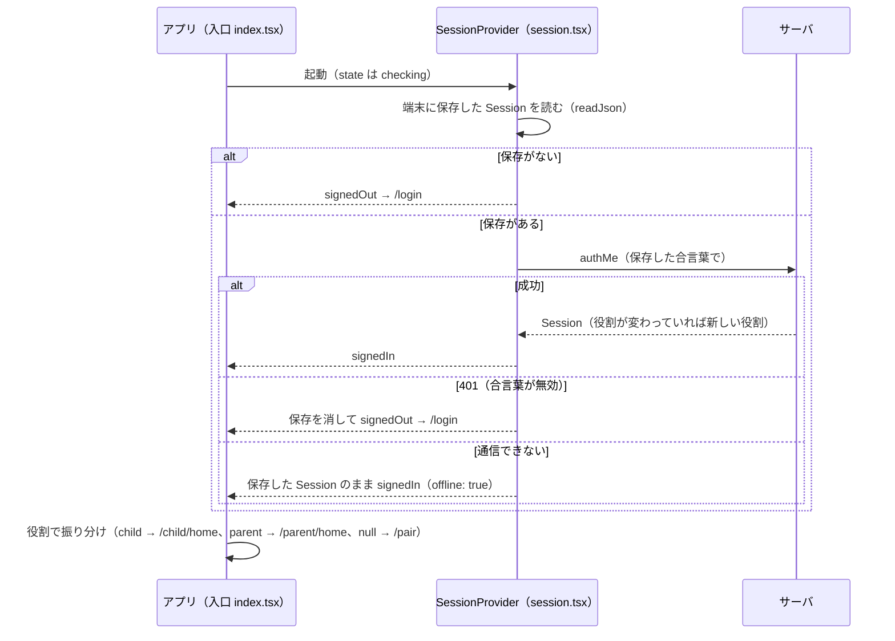
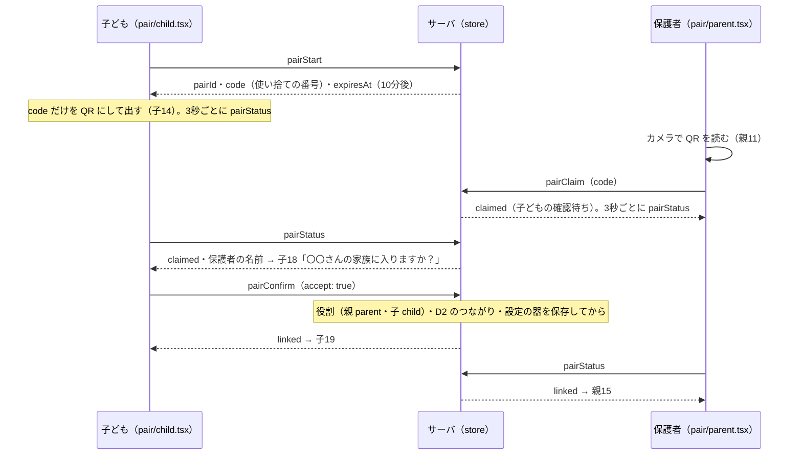
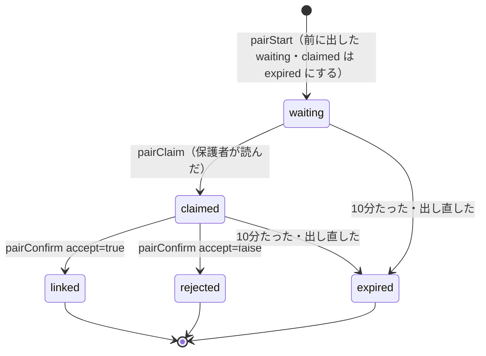
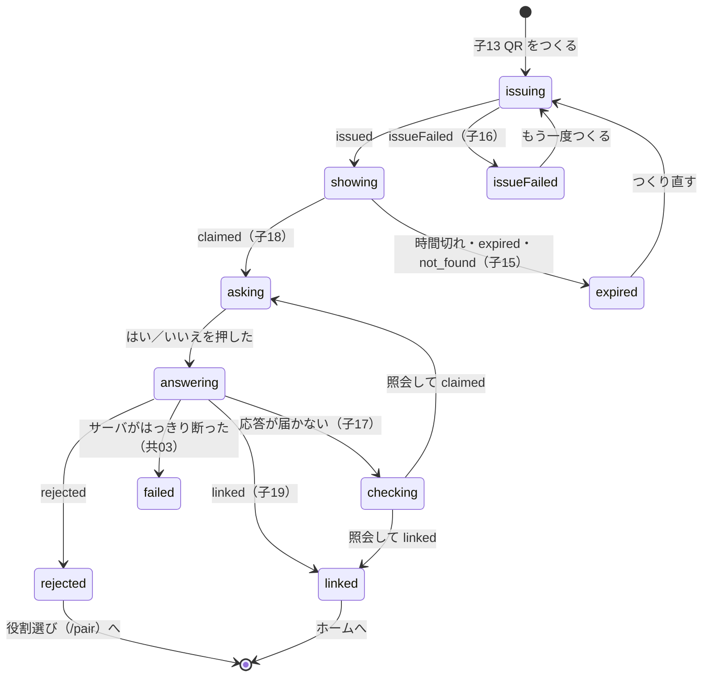
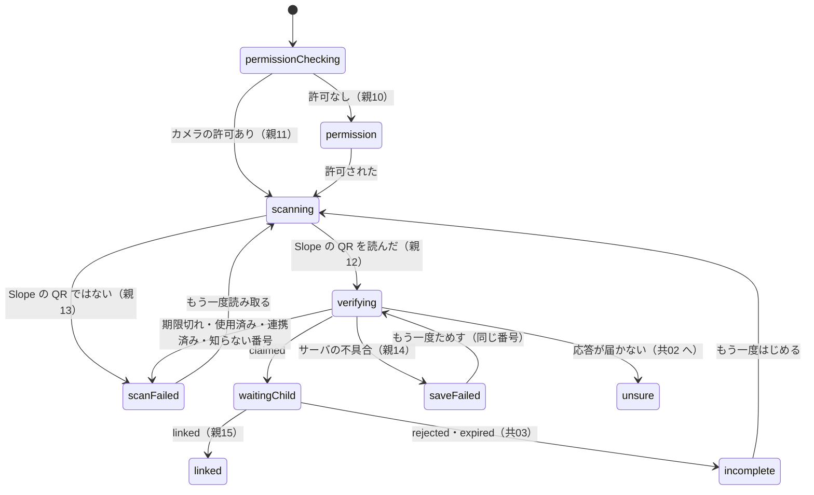
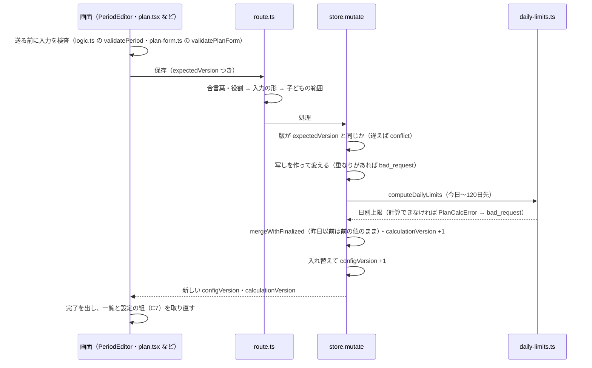
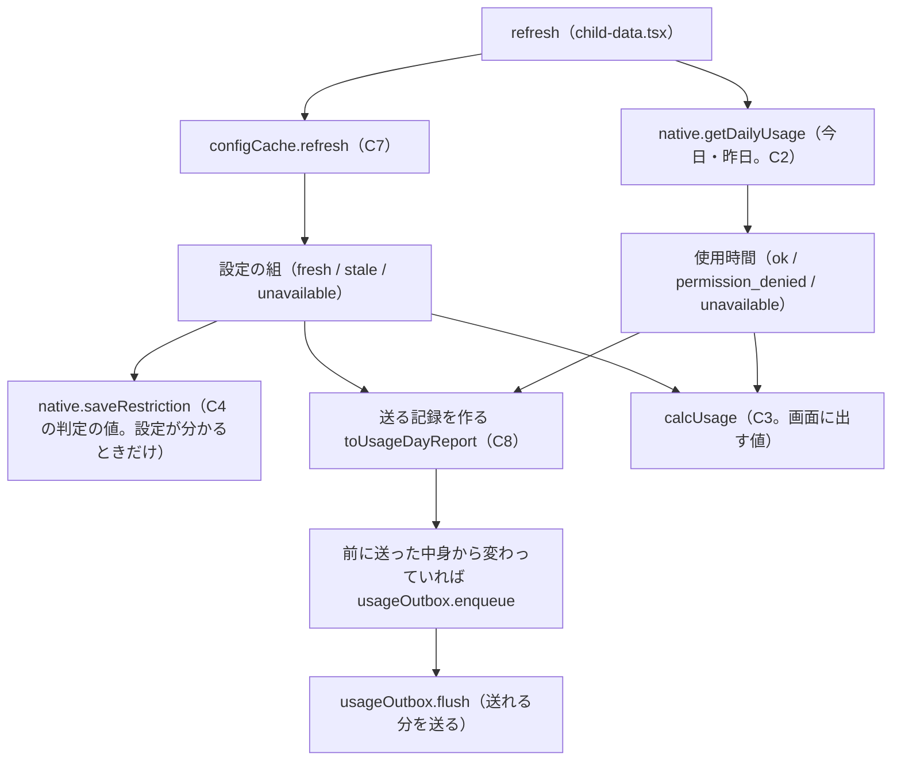

# 主な流れ（順番に）

アプリを起動してから、保護者が子どもの使った時間を見るまでを、段階ごとに説明します。
各段階に「どのファイルのどの関数が担当か」を書きました。API の細かい形は [api.md](api.md)、データの形は [data.md](data.md)、画面は [screens.md](screens.md) を見てください。

目次:

1. 起動とログイン（C1）
2. 役割選び
3. QR の紐づけ（C1）
4. 通常上限を決める
5. 計画・テスト期間・空白期間の保存と C10 の再計算
6. 子どもの端末が設定を取りに行く（C7）
7. 使用時間の計測（C2）と割合（C3）
8. 上限に届いたとき（C4）
9. 利用記録の送信（C8）
10. 保護者の画面（C6）
11. 制限対象外アプリ（C9）と反映済み／反映待ち

---

## 1. 起動とログイン（C1）

| 段階 | 担当 |
|---|---|
| 全体を包む | `src/app/_layout.tsx`（`SessionProvider` と `FlowProvider` で包む） |
| 起動時の確認 | `src/lib/session.tsx` の `verify`（`authMe` を呼ぶ。401 なら `forget`、通信できなければ `offline: true`） |
| 振り分け | `src/app/index.tsx`（`checking` は読み込み中、`signedOut` は `/login`、役割で `/child/home`・`/parent/home`・`/pair`） |
| ログイン画面 | `src/app/login.tsx`（子08・子09） |
| Google か MOCK か | `src/lib/google.ts` の `googleSignInEnabled`（`EXPO_PUBLIC_GOOGLE_WEB_CLIENT_ID` があれば本物） |
| 本物の Google | `signInWithGoogle` → ID トークン → `useSession().signIn(idToken)` → `call("authGoogle")` |
| MOCK | `mockLoginChoices` の3つのボタン（保護者・子ども・はじめての人）。「はじめての人」は端末ごとの番号つき（`mock-new-<端末の番号>`） |
| サーバの確認 | `src/server/handlers/authGoogle.ts`：`mock-` で始まれば `MOCK=1` のときだけ `store.signInMock`。それ以外は `auth/google.ts` の `verifyGoogleIdToken`（署名・発行元・宛先・期限）→ `store.signInGoogle`（初めての人は登録。役割は `null`） |
| 合言葉の保存 | `session.tsx` の `adopt`：`setSessionToken`（以後の `call()` に付く）と端末への保存 |
| 使っている途中の 401 | `src/lib/api.ts` が `setUnauthorizedHandler` で登録された関数を呼ぶ → `session.tsx` がログアウト状態にし、ログイン画面に「ログインの期限が切れました」の帯（`login-view.ts` の `loginNotice`） |
| 失敗 | 子09 のダイアログ。Google で「やめた」はエラーにしない（`login-view.ts` の `googleOutcome`） |

合言葉の期限は「最後に使ってから30日（使うたびに延長）」です（`store.ts` の `SESSION_IDLE_MS`・`findSession`）。

## 2. 役割選び

ログインしただけでは役割は `null` です。`/pair`（`src/app/pair/index.tsx`）に来ます（Q1）。

1. 開いたらすぐ `call("linkStatus")` で D2（家族のつながり）を照会する（15秒で時間切れ）。
2. 判断は `src/components/pair/link-check.ts` の `linkCheckView("check", …)`:
   - 照会できない → **共01**「連携状態を取得できない」（`LinkUnknown`）。未連携と決めつけず、QR へは進ませない。
   - 連携済み → `useSession().refresh()` で役割を取り直して入口へ。
   - 未連携 → 「保護者として使う」（→ `/pair/parent`）と「子どもとして使う」（→ `/pair/child`）を出す。
3. ここで選んだ役割は**端末の中だけ**です。サーバ上の役割は、次の QR の紐づけが確定したときに決まります。

## 3. QR の紐づけ（C1）

子どもが QR を出し、保護者が読み、子どもが「はい」で確定する **3段階** です（FigJam の2段階ではなく、作り直し前の設計に合わせた）。

### サーバの状態（`PairState`）

- 担当は `src/server/mock/store.ts` の `pairStart`・`pairClaim`・`pairConfirm`・`pairStatus`。期限切れは「聞かれたときに確かめる」（`refreshExpiry`）。
- QR は10分・1回だけ・出し直したら前の QR は無効（Q10）。`rejected` の QR も、もう読めない。
- `pairClaim` で断るもの: 子どもの端末（forbidden）、知らない番号（not_found）、期限切れ・使用済み・自分の QR・すでに誰かと連携済み（conflict）。
- `pairConfirm` で断るもの: QR を出した子ども以外（forbidden）、期限切れ・まだ読まれていない・役割が合わない・その間に別の相手と連携した（conflict）。
- 親1人↔子1人（Q2）: すでに連携している人は QR を出せない・読めない・確定できない（`oneToOne` の conflict）。

### 子どもの画面の移り変わり（`src/components/pair/child-flow.ts` の `childPairReducer`）

- `showing` の間に通信できないと「通信できません」の帯を足す（QR は出したまま）。
- 子14 の残り時間は端末の時計で数える（`localDeadline`・`remainingLabel`）。端末の時計がずれて期限がおかしく見えるときは「受け取ってから10分」にする。
- 進み具合は `PAIR_POLL_MS`（3秒）ごとに `pairStatus` で聞く（`shouldPoll` が true の間だけ）。
- 「やめる」は役割選びに戻るだけ。**QR を取り消す API はない**ので、出した QR は期限まで残る（子どもが「はい」を押さない限りつながらない）。
- 「はい」の応答が届かない（通信・時間切れ・サーバの不具合）ときは、成功とも失敗とも言わず **子17** で照会を続ける（MVP_SPEC 4.1）。

### 保護者の画面の移り変わり（`src/components/pair/parent-flow.ts` の `parentPairReducer`）

- 読んだ文字列は送る前に形を確かめる（`qrCodeOf`。英数字と `-` `_` の 8〜128 文字）。URL など Slope 以外の QR はサーバに送らず親13 にする。
- `waitingChild`（子どもの「はい」待ち）は Figma にない表示（`pair/parent.tsx` の `TODO(未決)`）。
- `unsure` になったら `/pair/status?reason=unsure&role=parent` へ移る。

### 失敗したとき（共01〜共03）

`src/app/pair/status.tsx` と `link-check.ts` の `linkCheckView("unsure", …)`:

| 照会の結果 | 出すもの |
|---|---|
| まだ照会していない | **共02**「連携結果が未確定」（押したら照会） |
| 照会できない | 共02 のまま（不明。失敗と言わない） |
| `linked` | 役割を取り直して入口へ（成功していた） |
| `unlinked` | **共03**「まだつながっていません」→「もう一度はじめる」は同じ役割の紐づけへ（`restartHref`） |

### つながった後

- 子ども: 子19「ホームへ」→ `refresh()`（役割が `child` になる）→ 入口 → `/child/home`。
- 保護者: 親15「1日の上限を決める」→ `refresh()`（役割が `parent`）→ `/pair/usual-limit`。つながった子どもは `flow.tsx` の `setChild` で次の画面に渡す。
- サーバは `pairConfirm` で子どもの設定の器（版 0・すべて空）を作る（`configFor`）。

## 4. 通常上限を決める

紐づけの直後に、保護者が「テストがない日の1日の上限」を決めます（Q7）。画面は `src/app/pair/usual-limit.tsx`（Figma にない。下部タブなし）。

1. 子どもは `flow` の `child`。なければ `call("familyGet")` の1人目。
2. `call("planGet")` で今の版（`configVersion`）と、決めてあれば今の通常上限を取る。
3. 入力は「時間」と「分」。`src/components/pair/usual-limit-input.ts` の `parseUsualLimit`（全角の数字も可・片方だけなら他方は 0・0〜1440 分）。
4. 「決める」→ `call("usualLimitSave", { childId, expectedVersion, usualLimitMinutes })`。サーバは保存と C10 の再計算を終えてから返す。
5. 成功 → `refresh()` → 入口 → `/parent/home`。版がずれていた（conflict）→ 入力を残して版を取り直す。
6. 「あとで決める」→ 入口へ。その間、計画やテストがない日は「上限未設定」（0 分とも制限なしとも違う）。親01 には「1日の上限がまだ決まっていません」の帯と「1日の上限を決める」ボタンが出る。

## 5. 計画・テスト期間・空白期間の保存と C10 の再計算

| 何を | 誰が | 画面 | API |
|---|---|---|---|
| 通常上限 | 保護者 | `pair/usual-limit.tsx`（親02 でも変えられる） | `usualLimitSave` |
| 計画（開始日・S・G、通常上限も一緒に） | 保護者 | `parent/plan.tsx`（親02） | `planSave` |
| テスト期間 | 親子どちらも（Q11） | 子03・子05・子10（`child/schedule-*.tsx`）、親05（`parent/schedules.tsx`） | `testPeriodCreate`・`Update`・`Delete` |
| 空白期間 | 保護者だけ | `parent/blank-periods.tsx`（親02 から入る） | `blankPeriodCreate`・`Update`・`Delete` |

- 担当: `src/server/mock/store.ts` の `mutate`（全体）と `recalculate`（C10）。途中で失敗したら何も変えない（前の正式な版を保つ。Q5・AC-07）。
- C10 の式と例は [data.md の 4章](data.md) にあります。
- **今日から先だけ**を計算し直し、昨日以前の日別上限は変えません（Q4。`mergeWithFinalized`）。
- 計画の開始日は**今日以降**でないと保存できません（`store.planSave`。デモの見本だけ例外 `allowPastStart`）。
- 対象外アプリの保存（C9）は C10 を計算し直しませんが、版は上がります。
- 画面側:
  - 日程: `src/components/schedule/PeriodEditor.tsx`（保存は `actions.ts` の `savePeriod`・`deletePeriod`）。**変更・削除**は入力を始めた時点の版を送り、**登録**は最新の版を送る（30秒ごとの取り直しで最新の版を送ると、ほかの端末の変更を黙って上書きしてしまうため）。失敗の出し分けは `logic.ts`（conflict → 読み込み直し・bad_request → 入力を残してサーバの文・not_found → 一覧へ・通信 → もう一度）。
  - 計画: `src/app/parent/plan.tsx` の `save`。保存の応答のあと、設定の組を取り直して新しい日別上限がそろってから「計画を作りました」（`plan-form.ts` の `saveConfirmation`）。
  - 保存のあと、子どもの画面は `useChildData().refresh()`、保護者の画面は `useParentData().refresh()` で設定の組を取り直す。

## 6. 子どもの端末が設定を取りに行く（C7）

子ども用の画面は `src/app/child/_layout.tsx` が `ChildDataProvider`（`src/lib/child-data.tsx`）で包みます。
`usePolling`（`src/lib/polling.ts`）が、**画面が出ている間 30秒ごと・画面を開いたとき・アプリが前面に戻ったとき**に `refresh` を呼びます（前の回が終わっていなければ飛ばす `singleFlight`）。

`refresh` の中身（どれかが失敗しても、ほかは続ける）:

C7 の決まり（`src/lib/config-cache.ts`）:

1. 起動直後は、端末に保存した組をすぐ出す（`load`。通信を待たない。理由 `not_checked` の stale だが、帯は出さない）。
2. `configGet` に手元の版を `knownVersion` として送る。サーバは、子どもが送った版を「子どもの端末が使っている版」（`childAppliedVersion`）として覚える（Q6）。
3. 応答の扱いは純粋な関数 `reconcileConfig`:

| 応答 | 判断 |
|---|---|
| `changed: false` で手元の版と同じ | `keep`（手元が最新） |
| `changed: false` だが手元にその版がない | `refetch`（版を付けずに取り直す） |
| 別の子どもの組・同じ日付が2つある組 | 捨てる（`invalid`） |
| 手元より古い版 | 捨てる（`older_response`） |
| 同じ版なのに中身が違う（作った時刻だけの違いは同じとみなす） | 捨てる（`integrity`） |
| 新しい版 | 採用して端末に保存（`adopt`） |

4. 通信に失敗したら、最後に正常だった組を `stale`（最新でない可能性あり）で返す。手元にもなければ `unavailable`（取得不可。上限を 0 分として扱わない）。
5. 待っている間にほかの取得が新しい組を保存したかもしれないので、比べる前に読み直す（古い応答で上書きしない）。
6. 子どもの画面は stale のとき「最新でない可能性があります」の帯を出す（`child-view.ts` の `staleNotice`。`not_checked` のときは出さない）。

## 7. 使用時間の計測（C2）と割合（C3）

**C2（使用時間）**: `src/lib/native.ts` の `getDailyUsage(date)`。

- Kotlin に `getDailyUsage` があればそれを呼ぶ（**今はまだない**）。
- ないとき: `EXPO_PUBLIC_FAKE_USAGE=1`（または `setFakeUsage(true)`）なら仮の値（`contracts/fixtures.ts` の `demoAppMinutes` を時刻に合わせて増やしたもの）。そうでなければ `{ status: "unavailable" }`（0 分にしない）。
- 権限がなければ `permission_denied`（Kotlin ができたら返す想定）。画面は使用状況へのアクセスの設定を開く案内を出す（`native.openPermissionSettings("usageAccess")`）。

**C3（割合と到達）**: `src/lib/usage-calc.ts` の `calcUsage`。`child-data.tsx` が `useMemo` で計算して `calc` として配る。

1. 使用時間が取れない（`permission_denied`・`unavailable`）→ その状態を先に返す（上限があっても 0 分として計算しない）。
2. その日の上限を `limitForDate(snapshot, date)` で取り出す: 組がない＝`unknown`、日付がない＝`unset`（未設定）、空白期間＝`unlimited`、それ以外＝`set`。
3. 制限対象の合計 = 対象外アプリ（C9）と必須例外（`ESSENTIAL_PACKAGES`。電話など）を除いた分の合計（`restrictedMinutes`）。
4. 上限 0 分 → 到達・表示 100%・残り 0%（0 で割らない）。
5. それ以外 → 実際の使用率 = 使用 ÷ 上限 × 100（100 を超えてもそのまま持つ）。表示は 0〜100 に収めて四捨五入。残り％ = max(0, 100 − 表示)。到達は「使用 ≥ 上限」（Q17 は未決。仮）。

画面（`src/components/child/child-view.ts` の `usageView`）は、割合が出せない状態（上限未設定・制限なし・権限なし・取得不可）では数字を出さず、それぞれの文を出します。子どもには分数を主に見せません（割合が主。MVP_SPEC 4.2）。
子02 の今週の棒グラフは、過去の日の端末の記録（`native.getDailyUsage(日付)`）とその日の日別上限から、同じ計算で割合を出します（`dayCalc`・`weekBars`）。

## 8. 上限に届いたとき（C4）

- 判定の値: `child-data.tsx` の `refresh` が毎回 `native.saveRestriction({ date, limit, excludedPackages, essentialPackages, learningPackages, configVersion })` で Kotlin に渡す。`limit` は `limited`／`unlimited`／`unset` を分けて渡す。設定が分からないときは渡さない（前の値で判定を続ける）。
- **今の画面の動き**: 子01 ホーム（`src/app/child/home.tsx`）が見えている間に `calc` が到達になったら、その日に1回だけ `native.showLimitReached()` を呼び（Kotlin がなければ何もしない）、子11（`/child/limit-reached`）へ進む（`child-view.ts` の `shouldOpenLimitScreen`）。
- 子11（`src/app/child/limit-reached.tsx`）: 「今日のスマホの時間は終わりです。続きはあしたにしよう」・今日の使用量・次のテスト・「お勧めアプリはこちらです ›」（`RECOMMENDED_APP_PACKAGES` を上から順に `native.openApp` で試す。開けなければ案内のダイアログ）・「閉じる」。
- Android は他のアプリを無条件には止められません（MVP_SPEC 2章）。子11 は「案内」で、遮断は約束しない文にしています。
- Kotlin の監視（`startEngine` など）は窓口だけで、今のコードからは呼んでいません。

## 9. 利用記録の送信（C8）

担当: `src/lib/usage-outbox.ts`（送信待ち）、`src/lib/usage-calc.ts` の `toUsageDayReport`（記録の形）、`src/server/mock/store.ts` の `usageUpload`。

1. 記録の中身（Q8）: その日の**アプリ別の累計**・**測った時刻**・**制限対象の合計分**（C3 と同じ判定）。毎回「今日と昨日」の2日分（取れた日だけ）。
2. 送る頻度（Q9）: C7 と同じきっかけ（30秒ごとなど）。前に送信待ちへ入れた中身と比べ、変わっていなければ入れない（測った時刻だけの違いは無視）。この「前の中身」はメモリにだけ持つので、アプリを開き直した最初の1回は必ず入れる。
3. `enqueue`: 送信 ID（UUID）を**1回だけ**作って端末に保存する。送り直しても同じ ID を使う。
4. `flush`: 送れるものを順に送る（同時に2回呼ばれても1回だけ動く）。

| 結果 | 動き |
|---|---|
| `accepted`・`duplicate` | サーバに保存済みなので送信待ちから消す |
| 直らない失敗（`bad_request`・`forbidden`・`conflict`・`not_found`） | その記録だけ**隔離**（`quarantined`）。自動では送り直さない。ほかの記録は送り続ける |
| それ以外（通信・時間切れ・サーバの不具合・`rate_limited`・`unauthorized`） | 送信待ちのまま。30秒・60秒…と倍にして最大15分あけて送り直す（`backoffMs`。回数の上限なし） |

5. サーバ側（`usageUpload`）:
   - 同じ送信 ID・同じ中身 → `duplicate`（二重に保存しない）。日やアプリの並びだけが違うのは同じ中身とみなす（`fingerprintOf`）。
   - 同じ送信 ID で中身が違う・別の子ども → `conflict`。
   - 日ごとに「測った時刻が一番新しい記録」を正とする（古い記録が後から届いても上書きしない）。採用した日を `appliedDates` で返す。
6. 送信待ちの一覧（`list`）と隔離の解除（`retryQuarantined`）の関数はあるが、今の画面からは使っていない（未送信の件数は画面に出ていない）。
7. ログアウトしても送信待ちは消さない（`storage.ts` の `clearSessionData` は合言葉だけを消す）。

## 10. 保護者の画面（C6）

保護者用の画面は `src/app/parent/_layout.tsx` が `ParentDataProvider`（`src/lib/parent-data.tsx`）で包みます。

- 30秒ごとなどに `call("familyGet")` で連携済みの子どもを取り、見ている子ども（`flow` の `child`）がいなければ1人目にする。
- 見ている子どもの設定の組を `configCache.refresh(child.id)` で取る（C7 と同じ仕組み。保護者が呼んでも「子どもが使っている版」は変わらない）。
- 子どもが決まるまでの表示（読み込み中・取得不可・まだつながっていない）は `src/components/parent/data.tsx` の `ChildGate`。

子どもの実績（分）は画面ごとに期間が違うので、各画面が `useUsage(childId, from, to)`（`data.tsx`。中で `call("usageGet")` を30秒ごと）を呼びます。失敗したら前に取れた値を stale として残します。

| 画面 | 期間 | 何を出すか |
|---|---|---|
| 親01 ホーム（`parent/home.tsx`） | 今週の月曜〜日曜 | 今日の分数／上限・進捗バー、今週の棒グラフ（`charts.ts` の `homeWeekBars`）、次のテスト |
| 親03 振り返り（`parent/review.tsx`） | 今週の前3週〜後2週（`reviewRange`） | 期間の帯、上限の減り（`review.ts` の `limitReduction`）、週ごとの平均（`reviewWeekBars`）、テストのあとのお知らせ（`afterTestNote`） |
| 親09 アプリごとの利用時間（`parent/app-usage.tsx`） | 今日だけ | 制限の対象と対象外に分けたアプリ別の分数（`today.ts` の `appUsageRows`） |

取り違えないための決まり（`today.ts`・`charts.ts`）:

- 記録がない日（`recorded: false`）は「まだ記録が届いていません」・グラフは中身を描かず「？」。0 分の記録は「0 分」。
- 上限が「制限なし」の日は「制限なし」・グラフの上は「なし」。「上限未設定」の日は「上限未設定」・グラフの上は「－」。
- 親の端末の使用時間は子どもの記録として使わない（MVP_SPEC 5.2）。親の画面は C2 を呼ばない。
- 上限の下がり方（親02 のグラフ・親03 の減り）は、サーバの日別上限をそのまま拾う。端末で C10 を計算し直さない。

## 11. 制限対象外アプリ（C9）と反映済み／反映待ち

### 対象外アプリ

- 画面: 親16（`src/app/parent/excluded-apps.tsx`）。保存できるのは保護者だけ（サーバも `auth: "parent"` で確かめる）。
- 候補の一覧は **MOCK の固定値**（`contracts/fixtures.ts` の `mockExcludedAppCandidates`：学習ノート・英単語カード・動画アプリ・ゲーム）＋保存済みのアプリ。子どもの端末のアプリ一覧をサーバへ送る API は作っていません（Q15 保留）。
- 保存は `call("excludedAppsSave", { childId, expectedVersion, apps: 全件 })`（差分ではなく全件の置き換え。`excluded.ts` の `appsToSave`）。
- サーバは、前から対象外だったアプリの `sinceVersion`（対象外になった版）を変えず、新しく入ったアプリには新しい版を付ける（`store.excludedAppsSave`）。
- 子どもの端末は次の C7 で新しい組を受け取り、以後の C3（合計から除く）と C4（`excludedPackages`）で使う。

### 反映済み／反映待ち（Q6）

「子どもの端末が使っている版」（`childAppliedVersion`）と「その変更が入った版」を比べます。子どもの端末が `configGet` で送った版をサーバが覚えるので、子どもの端末が次に取りに来ると「反映済み」になります。

| 画面 | 比べる版 | 担当 |
|---|---|---|
| 親02 計画 | 計画を保存した版（`plan.version`） | `plan-form.ts` の `reflectState` |
| 親05 テスト日程・空白期間の一覧 | 今の最新の版（`configVersion`）。ほかの種類の変更でも版が上がるので、その間は「反映待ち」になる | `schedule/logic.ts` の `appliedStatus` |
| 親16 対象外アプリ | アプリごとの `sinceVersion`。外したアプリは、この画面で保存したときの版を覚えて比べる（開き直すと分からなくなり「反映済み」とみなす。`TODO(未決)`） | `parent/excluded.ts` の `excludedRows` |

子どもの端末がまだ一度も取りに来ていない（`childAppliedVersion` が `null`）ときは「反映待ち」です。
