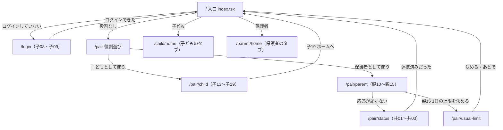

# 画面と部品

画面は Expo Router で作っています。**ファイルの場所がそのまま道（URL）**になります（例: `src/app/child/home.tsx` → `/child/home`）。
Figma の番号（子01・親01・共01 など）と node id は、Figma ファイル `UGp5tyARKxFRWzOl6KeKVP` の「最新」の画面のものです（各画面のファイルの先頭のコメントにも書いてあります）。
`docs/MVP_SPEC.md` の 5章の node id（`148:…`）は別の Figma ファイル（「ハッカソン練習向け」）のものなので、番号が違います。

## 1. 画面の道すじ

- ログイン・役割選び・QR・連携・通常上限の画面には**下部タブを出しません**（Q12）。
- 子ども用・保護者用のまとまりは、`_layout.tsx` が「ログインしていない・役割が違う」人を入口へ戻します（**画面で隠すだけでなく、サーバも役割を確かめます**）。

## 2. 画面の一覧

### ログイン・紐づけ（下部タブなし）

| ファイル | Figma | 役割 | 行き先 | 使うデータ |
|---|---|---|---|---|
| `src/app/index.tsx` | — | 入口。ログイン状態と役割で振り分ける | `/login`・`/pair`・`/child/home`・`/parent/home` | `useSession()` |
| `src/app/login.tsx` | 子08（108:6969）・子09（108:6983 ダイアログ） | Google ログイン。設定がなければ MOCK のボタン3つ | 入口 | `src/lib/google.ts`・`useSession().signIn` |
| `src/app/pair/index.tsx` | なし（Q1。共01 を流用） | 役割選び。先に連携状態を照会する | `/pair/parent`・`/pair/child`・ログアウト | `linkStatus` |
| `src/app/pair/child.tsx` | 子13（108:8926）〜子19（108:9037） | QR を出し、保護者の読み取りを待ち、「はい／いいえ」で確定。「やめる」は QR を取り消してから戻る | 入口（子19）・`/pair`（やめる・いいえ） | `pairStart`・`pairStatus`・`pairConfirm`・`pairCancel` |
| `src/app/pair/parent.tsx` | 親10（108:9050）〜親15（108:9130） | カメラの許可・QR の読み取り・子どもの確認待ち | `/pair/usual-limit`（親15）・`/pair/status`・`/pair` | `pairClaim`・`pairStatus` |
| `src/app/pair/status.tsx` | 共01（108:9143）・共02（108:9156）・共03（108:9171） | 結果が分からないときの照会 | 入口・同じ役割の紐づけ | `linkStatus` |
| `src/app/pair/usual-limit.tsx` | なし（Q7） | 紐づけ直後に通常上限を決める（親01 の帯からも来る） | 入口（→ 親01） | `familyGet`・`planGet`・`usualLimitSave` |

### 子ども用（下部タブ5つ。`src/app/child/_layout.tsx`）

| ファイル | Figma | 役割 | 行き先 | 使うデータ |
|---|---|---|---|---|
| `child/home.tsx`（タブ: ホーム） | 子01（108:6714） | 今日の使用量（％）・進捗バー・次のテスト | 「詳しく見る ›」→ 子02、到達したらその日1回だけ → 子11 | `useChildData()` の `calc`・`config`・`test`・`blank` |
| `child/usage.tsx`（タブ: 利用割合） | 子02（108:6741） | 円形ゲージ・ペースの札・今週の割合の棒グラフ | 「ホームに戻る」→ 子01 | `calc`、過去の日は `native.getDailyUsage` と日別上限 |
| `child/schedule-new.tsx`（タブ: 日程登録） | 子03（108:6809）・子04（108:6843 ダイアログ） | テスト期間の登録（名前・開始日・終了日） | 子01 | `testPeriodList`・`testPeriodCreate` |
| `child/schedule-list.tsx`（タブ: 日程一覧） | 子10（108:7005） | テスト期間の一覧（近い順） | 項目 → 子05、「＋ テストを追加する」→ 子03 | `testPeriodList`（取れなければ C7 の組） |
| `child/settings.tsx`（タブ: 設定） | 子07（108:6944）・子06（108:6906 ダイアログ） | テスト日程・テーマカラー（白だけ）・ログアウト（Q13） | 子10・ログアウト → 入口 | `config` の件数 |
| `child/schedule-edit/[id].tsx`（タブなし・タブは出たまま） | 子05（108:6878） | テスト期間の変更・削除（削除は Figma にないので足した） | 子10 | `flow` の `editTest`・`testPeriodList`・`testPeriodUpdate`・`Delete` |
| `child/limit-reached.tsx`（タブなし・タブは出たまま） | 子11（108:7024） | 上限に届いたときの案内・お勧めアプリ | 「閉じる」→ 子01 | `calc`・`config`・`test`・`LEARNING_PACKAGES`（`child-data.tsx` から）・`native.openApp` |

### 保護者用（下部タブ4つ。`src/app/parent/_layout.tsx`）

| ファイル | Figma | 役割 | 行き先 | 使うデータ |
|---|---|---|---|---|
| `parent/home.tsx`（タブ: ホーム） | 親01（108:7290） | 子どもの今日の分数／上限・今週の棒グラフ・次のテスト。通常上限が未設定なら帯 | 「詳しく見る」→ 親09、「1日の上限を決める」→ `/pair/usual-limit` | `usageGet`（今週）・`useParentData().config` |
| `parent/plan.tsx`（タブ: 計画） | 親02（108:7371） | 計画の開始日・S・G・通常上限。上限の下がり方のグラフ。反映済み／反映待ち | 「空白期間（夏休みなど）」→ 空白期間の画面 | `planGet`・`planSave`・`config` の日別上限 |
| `parent/review.tsx`（タブ: 振り返り） | 親03（108:7413） | 期間の帯・上限の減り・週ごとの平均・テストのあとのお知らせ | 「各アプリごとの利用時間を見る ›」→ 親09、計画がなければ → 親02 | `usageGet`（6週）・`config` |
| `parent/settings.tsx`（タブ: 設定） | 親04（108:7496）・親06（108:7548）・親07（108:7584） | テスト日程・制限対象外アプリ・テーマカラー（白だけ）・ログアウト（Q13） | 親05・親16・ログアウト → 入口 | `config` の件数 |
| `parent/schedules.tsx`（タブなし） | 親05（108:7529） | テスト期間の一覧と追加・変更・削除を1画面で切り替える | 「←」→ 親04 | `testPeriodList`・`Create`・`Update`・`Delete` |
| `parent/blank-periods.tsx`（タブなし） | なし（Q7。親05 と同じ見た目） | 空白期間の一覧と追加・変更・削除 | 「←」→ 前の画面 | `blankPeriodList`・`Create`・`Update`・`Delete` |
| `parent/app-usage.tsx`（タブなし） | 親09（108:7663） | 今日のアプリごとの利用時間（対象と対象外に分ける） | 「←」→ 来た画面 | `usageGet`（今日） |
| `parent/excluded-apps.tsx`（タブなし） | 親16（108:9446） | 制限対象外アプリのスイッチ・行ごとの反映済み／反映待ち・見出しの横に一覧の全体の反映の札 | 「←」→ 親04 | `excludedAppsGet`（`removedApps`・`appsChangedVersion` も使う）・`excludedAppsSave` |

### Figma にあって作っていないもの

- 子12・親08 ウィジェット（C5。MVP の後）。
- ダークテーマの画面（MVP の後）。テーマカラーのダイアログは「白色」だけ選べ、「黒色」は準備中として押せない。

### Figma にない画面・表示（足したもの）

- 役割選び（`/pair`。Q1）、通常上限（`/pair/usual-limit`。Q7）、空白期間（`/parent/blank-periods`。Q7）。
- 保護者の「子どもの返事を待っています」（`pair/parent.tsx` の `waitingChild`）。
- 子05 の「削除する」と削除の確認（`DeletePeriodDialog`）。親05 の追加・変更の入力（子03・子05 と同じもの）。

## 3. 下部タブ

| 子ども用（5つ） | 道 | 保護者用（4つ） | 道 |
|---|---|---|---|
| ホーム | `/child/home` | ホーム | `/parent/home` |
| 利用割合 | `/child/usage` | 計画 | `/parent/plan` |
| 日程登録 | `/child/schedule-new` | 振り返り | `/parent/review` |
| 日程一覧 | `/child/schedule-list` | 設定 | `/parent/settings` |
| 設定 | `/child/settings` | | |

タブに出ない画面は `_layout.tsx` で `href: null` にしてあり、開いてもタブは出たままです。タブの見た目は `src/components/TabIcon.tsx`（`tabBarOptions`）を親子で共有します。

## 4. 画面で使うデータの受け取り方

| 仕組み | 使う画面 | 中身 |
|---|---|---|
| `useSession()`（`src/lib/session.tsx`） | すべて | ログイン状態・`signIn`・`signOut`・`refresh` |
| `useFlow()`（`src/lib/flow.tsx`） | 紐づけ・日程・保護者 | 画面の間の受け渡し（見ている子ども `child`・編集するテスト `editTest`）。メモリだけ |
| `useChildData()`（`src/lib/child-data.tsx`） | 子ども用 | `config`（C7）・`usage`（C2）・`calc`（C3）・`test`（次のテスト）・`blank`（今日の空白期間）・`refresh` |
| `useParentData()`（`src/lib/parent-data.tsx`） | 保護者用 | `child`・`family`・`familyError`・`config`（C7）・`refresh` |
| `useUsage()`（`src/components/parent/data.tsx`） | 親01・親03・親09 | C6 の実績（30秒ごと） |
| `usePeriods()`（`src/components/schedule/usePeriods.ts`） | 日程の画面 | 期間の一覧と今の版（30秒ごと。取れなければ C7 の組を「古い」として出す） |

画面の中の判断（表示の出し分け・入力の検査・文言の組み立て）は、画面から切り離した純粋な関数にしてあります:
`src/components/child/child-view.ts`・`src/components/pair/*.ts`・`src/components/schedule/logic.ts`・`src/components/parent/*.ts`。

## 5. 共通部品（`src/components/`）

画面は `import { Screen, Card, Button } from "@/components";` のように使います（入口は `src/components/index.ts`。部品を足したらここにも1行足す）。

| 部品 | 使いどころ | 使い方の例 |
|---|---|---|
| `Screen` | 画面の枠（上のバー・左右の余白・下に固定する主ボタンの場所 `footer`） | `<Screen title="設定" onBack={…} footer={<Button …/>}>…</Screen>` |
| `AppText` | 文字。大きさは `variant`、色は `tone` で選ぶ | `<AppText variant="title">今日の使用量</AppText>` |
| `Button` | ボタン。`primary`／`outline`／`soft`／`text`／`pill`（枠付きの小さい丸いボタン。ダイアログの「OK」「キャンセル」「ログアウト」。高さは押せる高さの下限 44。Figma は 40）。`loading` の間は押せない | `<Button label="登録する" onPress={save} loading={saving} />`・`<Button variant="pill" label="OK" onPress={close} />` |
| `Card` | カード。`tone="soft"` は薄い青の地 | `<Card>…</Card>` |
| `Banner` | 帯の案内。`info`／`warning`／`danger`／`success` | `<Banner tone="warning" icon="cloud_off" message="最新でない可能性があります" />` |
| `ErrorBanner` | API の失敗の帯（`message` と `hint` をそのまま出す）。`null` なら何も出さない | `<ErrorBanner error={error} onRetry={load} />` |
| `StateView` | 状態の出し分け（下の表） | `<StateView state={configViewState(config)} onRetry={refresh}>…</StateView>` |
| `Dialog` | ダイアログ（完了・ログイン失敗・削除やログアウトの確認）。地は薄い紫（`tokens.color.dialog`）。`centered` で題名・本文・ボタンを中央にそろえる（Figma 子04・子06・子09・親07）。`iconTone` は `primary`／`success`／`danger` | `<Dialog visible={open} title="登録しました。" centered onClose={close} actions={<Button variant="pill" label="OK" onPress={close} />} />` |
| `MessageView` | 大きいアイコン＋題名＋本文＋ボタンの1画面（QR・連携の画面）。`spinner` で待ち。`tone` は丸の色、`iconTone` はアイコンの色（Figma は丸を薄い青のまま、アイコンだけ赤・緑にする） | `<MessageView icon="check_circle" iconTone="success" title="…" actions={…} />` |
| `ListItem` | リストの1行（設定・一覧）。`onPress` があれば › を出す。アイコンは既定で青（`iconTone`）、`strong` で題名を太字（Figma 子07・親04） | `<ListItem icon="event" title="テスト日程の一覧・変更" strong value="2件" onPress={…} />` |
| `LogoutListItem` | 「ログアウト」の行と確認のダイアログ（親07。子07 でも同じ。ボタンは `pill` の「キャンセル」「ログアウト」）。ログアウトすると端末の設定のキャッシュとその人の送信待ちも消える（`src/lib/sign-out.ts`） | `<LogoutListItem />` |
| `TextField` | 入力欄。`error` で赤い枠と文 | `<TextField label="テストの名前" value={name} onChangeText={setName} />` |
| `DateField` | 日付の入力（Android の日付の選択を開く）。値は `"YYYY-MM-DD"`。表示はいつも年つきの「2026年10月28日（水）」（`contracts/dates.ts` の `formatDateLongJa`） | `<DateField label="開始日" value={d} onChange={setD} />` |
| `ProgressBar` | 進捗バー（0〜100 に収める） | `<ProgressBar percent={calc.displayUsedPercent} />` |
| `Gauge` | 円形ゲージ（子02）。`null` なら「--」（0% と出さない）。`tone` は弧の色、`valueTone` は中央の数字の色 | `<Gauge percent={null} caption="使いました" />` |
| `BarChart`・`Legend` | 週の棒グラフ。値が `null` の日は中身を描かない | `<BarChart bars={…} scaleMax={100} />` |
| `Chip` | 小さい札（「ちょうどいいペース！」「反映待ち」「あと 9分41秒…」） | `<Chip tone="warning" label="反映待ち" />` |
| `Icon`・`IconBadge` | アイコン（Material Icons の形を SVG で描く。足すときは `paths` に1行）・大きいアイコンの丸 | `<Icon name="event" />` |
| `TabIcon`・`tabBarOptions` | 下部タブのアイコンと見た目 | `_layout.tsx` で使う |

### 状態の出し分け（`StateView`。MVP_SPEC 5.3）

| state | 意味 | 出すもの |
|---|---|---|
| `loading` | 読み込み中 | 何をしているかの文 |
| `success` | 取れた | 中身（children） |
| `empty` | 正しく取れたが0件（0 分とは別） | 「まだ記録がありません」など |
| `unknown` | 取得不可 | 再試行のボタン |
| `stale` | 古いキャッシュ | 「最新でない可能性があります」の帯＋中身 |
| `validation-error` | 入力が受け付けられなかった | エラーの帯＋入力欄はそのまま |
| `permission-denied` | 権限がない | 許可の案内と設定を開くボタン |

C7 の設定の状態は `configViewState(config)` で変換できます（`null` → loading、`unavailable` → unknown、`stale` → stale、`fresh` → success）。

### 機能ごとの部品

| フォルダ | 中身 |
|---|---|
| `src/components/child/` | `UsageSummaryCard`（今日の使用量）・`NextTestCard`・`UsageMessage`（割合が出せないときの文）・`RecommendAppsCard`・`ThemeDialog`、判断は `child-view.ts` |
| `src/components/pair/` | `QrCard`・`QrScanner`・`RoleChoice`・`LinkMessages`（共01〜共03 の中身）、判断は `child-flow.ts`・`parent-flow.ts`・`link-check.ts`・`login-view.ts`・`usual-limit-input.ts` |
| `src/components/schedule/` | `PeriodEditor`（登録・変更の1画面）・`PeriodForm`・`PeriodListScreen`・`PeriodManager`（保護者の一覧と入力の切り替え）・`PeriodRow`・`DeletePeriodDialog`・`ParentChildGate`、通信は `actions.ts`、判断は `logic.ts` |
| `src/components/parent/` | `DurationField`（◯時間◯分）・`WeekBars`・`parts.tsx`（`AppInitial`・`LinkCard`・`Note`・`Strip`・`Badge`）・`data.tsx`（`ChildGate`・`useUsage`）、判断は `charts.ts`・`excluded.ts`・`format.ts`・`plan-form.ts`・`review.ts`・`today.ts` |

## 6. 見た目の決まり

- 色・余白・角丸・文字の大きさ・部品の寸法は **`contracts/tokens.ts` の名前だけ**を使う。画面は `StyleSheet.create` の中で `tokens.color.primary`・`tokens.space[4]` のように書く。
- `style={{…}}` を書かない。色コード（`#3B5BDB` など）や数値の余白を画面に直書きしない。例外は、値で大きさが決まる所（`BarChart`・`ProgressBar`・`WeekBars` の棒の高さ・幅）だけで、そこも色と寸法は tokens を使う。
- 色の3つは MVP_SPEC 5章の値: 背景 `bg` `#FAF9FD`・アクセント `primary` `#3B5BDB`・薄い青 `primarySoft` `#DDE4FF`。ほかの色は Figma の見た目から近い値を置いた（ダイアログの地 `dialog`・枠付きボタンの枠 `outline` など）。
- 画面に出す日付の文言は `contracts/dates.ts` の `formatDateJa`・`formatDateLongJa`・`formatSlashDate`・`formatSlashDateWeekday` だけで作る。
- 寸法は Figma の画面（360×800）: 左右の余白 24（`layout.gutter`）、カードの間 16、ボタンの高さ 56、押せる部品の高さは 44 以上（`size.touch`）。
- 文字は責めない言い方にする（「ちょうどいいペース！」「続きはあしたにしよう」）。子どもには分数より割合を見せ、保護者には分数を見せる。
- ダークテーマは MVP の後。
- これらに自動の検査はありません（書く人とレビューで守る約束）。
